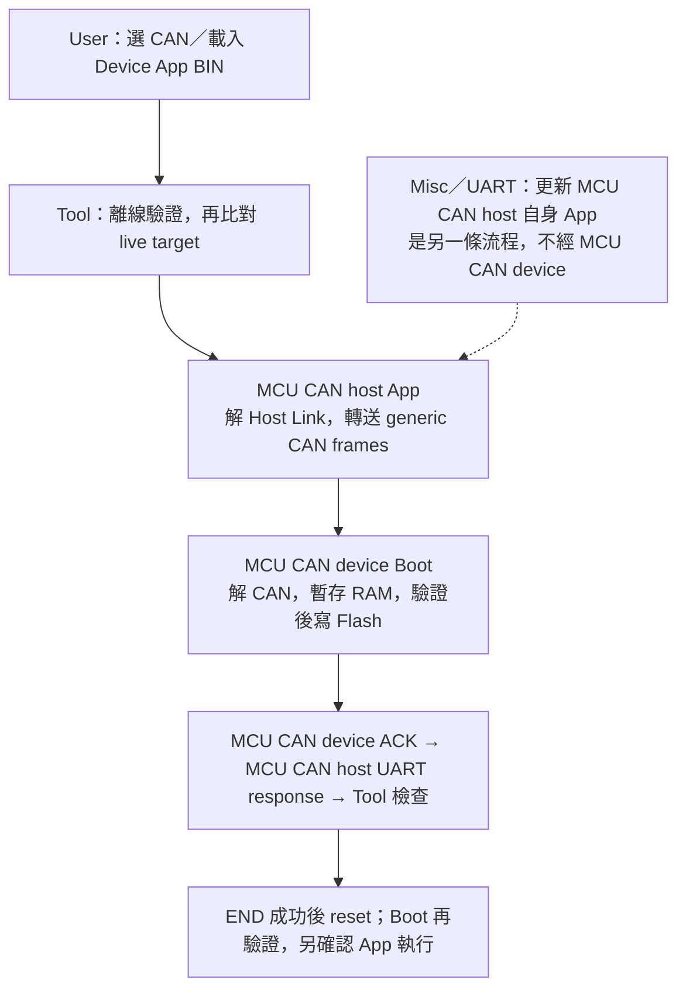
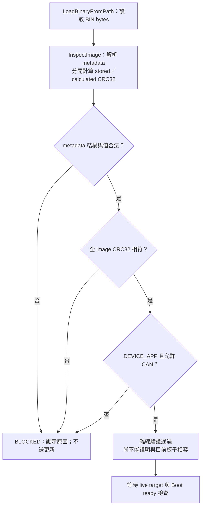
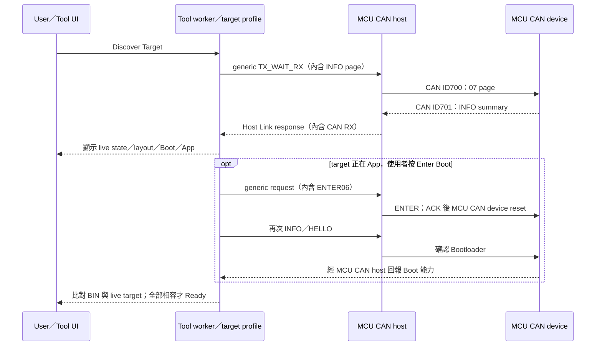
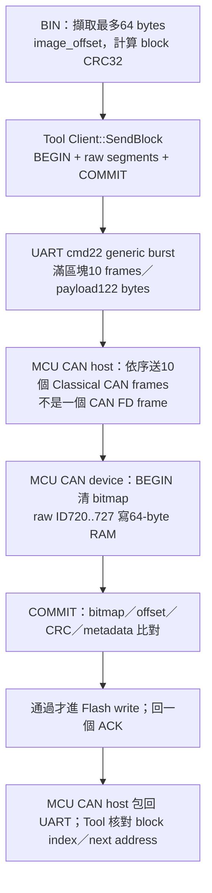
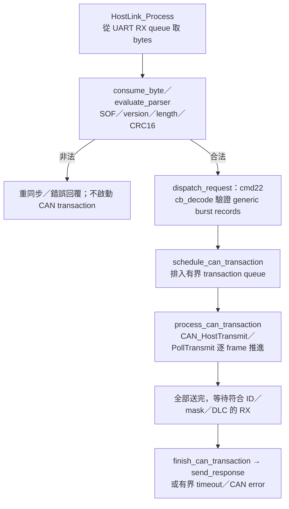
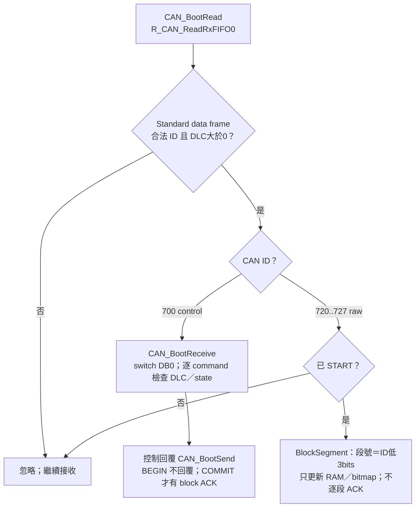
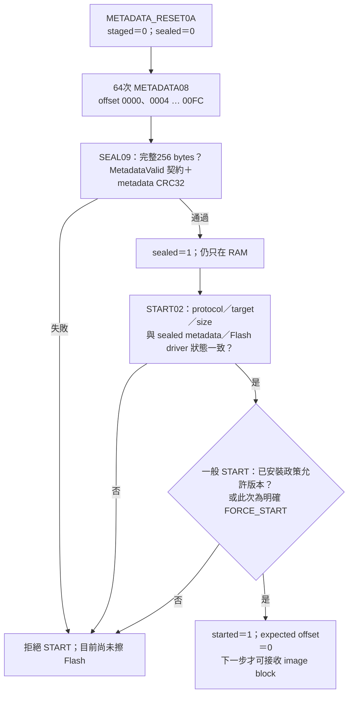
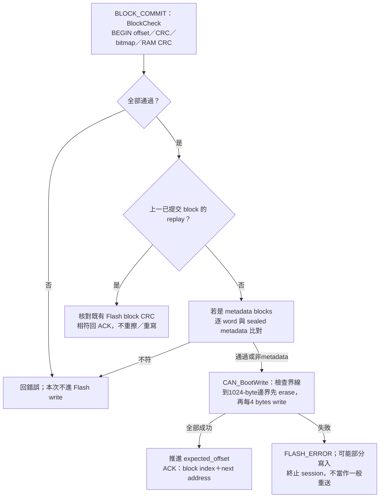
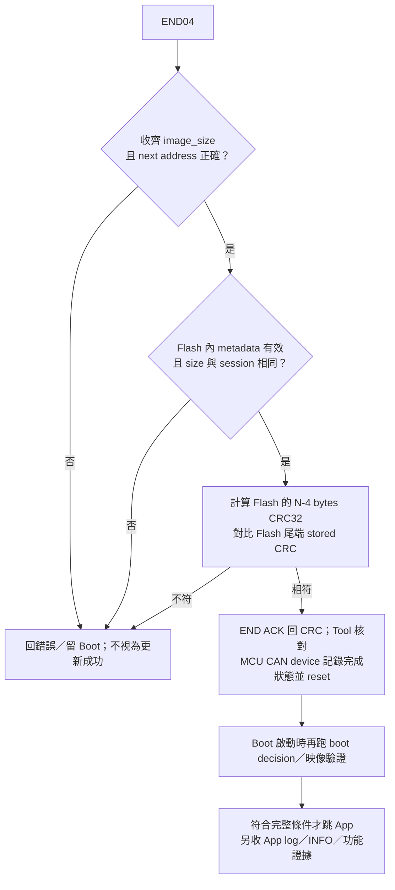

[知識庫首頁](https://released.github.io/) · [Simple Renesas ISP Tool 與 MCU bridge 操作](index.html)

# CAN 更新逐層導讀

對照 Tool、MCU CAN host 與 MCU CAN device 的資料流。

<!-- CAN_WALKTHROUGH_BEGIN -->

## CAN 更新逐層導讀：Tool → MCU CAN host → MCU CAN device

本篇以同一條更新路徑，對照 Tool 操作、傳輸資料、處理函式及 Flash 寫入時點。
完整 byte 規格見 [Flash／metadata 全部 byte 位址與 CAN 格式](https://released.github.io/slide_boot_loader_for_RL78/#flash-metadata-can-reference)。
[MD 原稿](https://github.com/released/simple_renesas_isp_tool/blob/main/docs/CAN_UPDATE_WALKTHROUGH_zh-TW.md)與
[可下載 PDF](https://github.com/released/simple_renesas_isp_tool/blob/main/docs/CAN_UPDATE_WALKTHROUGH_zh-TW.pdf)可供離線對照。

本篇以 **F13 Classical CAN** 的 CAN Upgrade 為範例：控制 ID `0x700/0x701`、raw data IDs `0x720..0x727`，
範例 App 起點 `0x2000`、metadata 位於 image offset `0x100..0x1FF`。這些是此範例契約，不是所有 MCU 的固定值。
Host 自身 App 的更新操作見 [Misc／UART](https://released.github.io/slide_simple_renesas_isp_tool/#host-bridge-firmware)。

### A. 三層責任與資訊來源

| 層 | 輸入與輸出 | 負責判斷 | 不負責的事 |
| --- | --- | --- | --- |
| PC Tool | BIN／UI → Host Link UART commands | 離線 BIN、更新政策、live target 相容性；建立 CAN 更新封包 | 不直接操作 device Flash register |
| MCU CAN host App | Host Link → CAN TX；CAN RX → Host Link response | UART framing／CRC16、generic CAN record、傳送完成與等待條件 | 轉送 CAN frames；App metadata 與擦寫由 device 處理 |
| MCU CAN device Boot | CAN command／raw data → ACK | metadata 契約、RAM 區塊、CRC、Flash 邊界、完整映像及 Boot→App | 不解析 PC Host Link、不需要知道 COM 名稱 |
| MCU CAN device App | CAN INFO／ENTER | 回報 App／Boot 摘要；明確要求重進 Boot | 不在正常 App 中處理 Boot 的區塊擦寫流程 |

#### 三層資料往返

| UI／通訊中看到的資料 | 來自哪裡 | 代表什麼 | 不代表什麼 |
| --- | --- | --- | --- |
| LOADED APP BIN／共用 metadata | PC 上載入的檔案 | 即將寫入的離線映像與更新政策 | 不是板上已安裝的內容 |
| DEVICE TARGET／BOOT CODE／INSTALLED APP | MCU CAN device 的 CAN INFO pages | live 韌體回報的身分、layout、版本、容量及政策摘要 | Discover 不會讀回完整 256-byte Flash metadata；也不是 read-back CRC |
| HOST BRIDGE／Host descriptor | MCU CAN host 的 Host Link 身分與自身 metadata | 哪塊 bridge、支援哪些 port／commands、Host 自身 App 資訊 | 與外部 device 的 App BIN 分開顯示 |

### B. 使用者操作與內部動作對照

| 操作順序 | UI 要看什麼 | 實際動作／程式入口 | F13 Flash 是否改變 |
| --- | --- | --- | --- |
| 1. 接線／開啟 Tool | COM friendly name 只協助選埠 | F24 與 F13／analyzer 同 CAN bitrate、共地、終端；F13 EVB TJA1050T 使用 5 V | 否 |
| 2. Open + Probe Host | HOST BRIDGE VERIFIED LINK／port／能力 | 讀 Host Link 身分與能力；支援自身更新的 bridge 再驗證其 descriptor／metadata | 否 |
| 3. CAN／Load Update Image | LOADED APP BIN 為 OFFLINE；CRC Result／Metadata Status／Update Policy | `CMainFrame::LoadBinaryFromPath` → `InspectImage`／`ValidateLoadedFirmwareImage`；選 `_update.bin`，不是 HEX 或 Host BIN | 否 |
| 4. Discover Target | DEVICE TARGET、BOOT CODE、INSTALLED APP | `ProcessDiscoverF13Boot` → `GetTargetInfo`：逐頁 INFO，核對模式／速度／IDs | 否 |
| 5. Enter Boot（若仍在 App） | DEVICE TARGET 改為 Bootloader | `ProcessEnterF13Bootloader` → ENTER ACK → 等待 reset → INFO + HELLO | 否 |
| 6. 檢查 Ready／Missing | 中央先決條件不得有缺項 | `CMainFrame::UpdateUi`；檔案、route、bit12、Boot ready、live layout 全部相容 | 否 |
| 7. Start Device Update | progress／shared log | worker 再驗證 → metadata RESET／stage／SEAL → START → blocks → END | 到有效 COMMIT 才開始 |
| 8. 確認結果 | END ACK 與 App confirmed 分開記錄 | Tool 等待 APP_READY，再比對 live INFO 與載入 BIN 的身分／版本／build／大小；自動保存報告 | 更新流程已寫入 |

載入 BIN 與 Probe 的先後可以互換；但 Start 前必須全部通過。Transfer Test／Bridge Self Test
只能用來排查通訊，不會替代 CAN Upgrade 的映像驗證。完整操作見[Tool operation](https://released.github.io/slide_simple_renesas_isp_tool/#tool-operation)。

### C. Tool 如何判斷「這個 BIN 可以更新」

| 驗證關卡 | 檢查的 byte／資料 | 拒絕範例 | UI／程式判定 |
| --- | --- | --- | --- |
| 最小結構 | entry／vector 預留、0x100 起 256-byte metadata、尾端 CRC4；至少 516 bytes、4-byte 對齊 | 空檔、截斷、只給原始 App code | `ParseMetadata`；entry 不得為 FFFFFFFF |
| 格式與識別 | image magic、image format、core length、flags、protocol、checksum；MCU 字串與 padding | BUR1 Host BIN 放在 CAN TAB、壞 magic／字串 | Metadata Status 與 Update Policy；不是只看副檔名 |
| 幾何與容量 | image_size 等於檔案長度；start／capacity／Flash／Boot／erase／minimum | 超出 Flash、start 未對齊 erase | `ParseMetadata` 的 bounds checks |
| 保留區 | metadata offset 0x80..0xFF 共 128 bytes 必須 FF | 不相容擴充欄位卻未更新契約 | reserved 檢查；不是任意填零區 |
| 完整性 | 檔案前 N-4 bytes 的 CRC32 對比最後 4 bytes LE32 | metadata 正確但程式區損壞 | CRC Result MATCH；`ValidateImage` 才要求相等 |
| 更新政策 | UPD1 role／allowed transports／IRQ ABI／minimum boot | CAN-only Device App 改選 I2C；Host App 放入 CAN | `image_policy::Allows`；切換 TAB 後重新核對更新政策 |

`InspectImage` 的「Metadata Status = VALID」與「CRC Result = MATCH」是兩個獨立結果，
兩者都通過也只是離線成立。CRC提供完整性，不是簽章或身分認證。

### D. 離線 BIN 與在線 target 如何比對

| 比對群組 | BIN metadata | live INFO／Host 能力 | 失敗後處理 |
| --- | --- | --- | --- |
| 身分 | target_id、mcu_family、mcu_part | target INFO 相同欄位 | 不以 USB-UART 描述或載入檔案推測身分 |
| 協定 | image format、protocol ID／version、checksum | live format／protocol／checksum | 使用 BEGIN／raw data／COMMIT 區塊流程 |
| Flash | start、capacity、Flash size、Boot reserve、erase、minimum | live layout 各項相等 | 不只比較 image 是否小於 capacity |
| CAN | mode／ID format／nominal mask／data mask／request／response | live 契約相同；選定設定也要被支援 | 改 bridge 速度不會改 F13 固定速度 |
| 政策 | DEVICE_APP、CAN allowed、固定 IRQ ABI、minimum boot | live role／CAN allowed／IRQ ABI；boot_version 足夠 | UI 與 worker `ImageMatchesTarget` 分別核對 |
| 傳輸能力 | 本路徑需要 generic burst | Host Link v2／128-byte payload／bit12；F13 block INFO | 缺 bit12 先經 Misc 更新 Host App，不直接開始 |
| 執行狀態 | 檔案有效且 App Start Override 相容 | 已確認 Bootloader；HELLO target／capacity 與 INFO 相符 | App 狀態須先 ENTER；未開 COM／busy 都不可更新 |

### E. 一個 BIN 區塊如何穿過 UART 與 CAN

| 名詞／單位 | 大小 | 本路徑的用途 | 範圍與差異 |
| --- | --- | --- | --- |
| metadata region | 256 bytes | image offset 0x100..0x1FF；128 core + 128 reserved | 不是 Host Link 單包大小 |
| metadata staging chunk | 4 bytes | METADATA08 每次攜帶 4 個 metadata bytes，總共 64 次 | 不是目前 raw App data 的有效長度 |
| image block | 最多 64 bytes | RAM staging／區塊 CRC／一次 COMMIT ACK | 不是 CAN FD frame |
| raw CAN data frame | 最多 8 bytes | ID 的低 3 bits 表示段號，payload 全部是 image bytes | 沒有占用 Byte0 當 command；最後一段可為 DLC4 |
| Host Link burst payload | 完整 block 為 122 bytes | 12-byte burst header + 10 ×（ID2 + DLC1 + data8） | 在 128-byte payload 上限內；含 UART framing 共 136 bytes |
| Flash write word／erase block | 4／1024 bytes | F13 以 4 bytes 寫入，到 erase 邊界時擦 1 block | 寫入單位不是 CAN 傳輸單位 |

#### 區塊封裝與回覆

### F. F24 (MCU CAN host) 的接收與轉送流程

| 程式位置 | 檢查／動作 | 使用者可對照的結果 |
| --- | --- | --- |
| `host_link_protocol.c`：`validate_header`／`evaluate_parser` | UART header CRC16、payload 長度 ≤128、payload CRC16；逐 byte 可分段到達 | UART framing／CRC 錯誤與 CAN target status 是不同層 |
| `can_burst.inc`：`cb_decode` | 1..10 records、Standard ID、DLC≤8、timeout、非零 mask、完整長度／gap | 不合法 generic request 直接 BAD_ARGUMENT；尚未解 F13 command |
| `host_link_protocol.c`：`schedule_can_transaction` | 有界 queue／相同 sequence 與 payload 的重送處理 | 不因 UART retry 任意增加 target Flash 寫入 |
| `host_link_can_process.inc`：`process_can_transaction` | 非阻塞 TX／GAP／RX／ABORT；所有 frame 送完後等待 matching RX | bridge TX complete 只代表 CAN 傳送階段完成 |
| `can_fd_module.c`：`CAN_HostTransmit` | 把已解碼的 frame 結構交給 `R_CAN_SendByTXMB`；ISR 記錄事件／RX queue | 寄存器與 driver 留在 board backend，不把 target 邏輯放 ISR |
| `finish_can_transaction`／`send_response` | 將 CAN RX record 放進同 sequence 的 Host Link response | 外層 status OK 後，Tool 還要解析內層 F13 status／detail／value |

Host Link 的 115200／460800／921600 是 PC↔F24 這一路；CAN 的 500K 是 F24↔F13 另一路。
F24 不會把 UART baud 寫入 F13 metadata，也不會將收到的 BIN 自動燒進自己的 App。
F24 自身更新另見[Misc 更新 Host App](https://released.github.io/slide_simple_renesas_isp_tool/#host-bridge-firmware)。

### G. F13 (MCU CAN device) 如何分類 CAN RX

| 收到內容 | Decoder 看哪裡 | 狀態／長度要求 | 結果 |
| --- | --- | --- | --- |
| INFO07／HELLO01 | DB0、INFO 的 DB1 page | INFO DLC2；HELLO 回報 Boot 狀態／能力 | 讀摘要；不寫 Flash |
| METADATA08 | DB1..2 metadata offset、DB3=00、DB4..7 bytes | 未 START、DLC8；offset 4-byte aligned 且不可跳過 | 寫 metadata RAM，回下一 offset |
| SEAL09／START02 | SEAL 的 DB4..7 CRC；START 的 protocol／target／size | metadata 256 bytes 完整、契約與 CRC 正確才允許 START | 只建立 update session；不擦 Flash |
| BLOCK_BEGIN0B | DB1..3 image offset、DB4..7 block CRC | 已 START、DLC8；64-byte offset；本區塊或上一已提交區塊 | 初始化 block RAM／bitmap；不 ACK |
| raw ID720..727 | index=ID&7；DB0..7 都是 image data | 已 START、BEGIN 有效；DLC 必須等於該段實際長度 | 收齊 bitmap；相同重複可接受，衝突使 block 無效 |
| BLOCK_COMMIT0C | offset／CRC 與 BEGIN 一致 | started、DLC8、bitmap 全、區塊 CRC 相等 | 通過後才比對 metadata／寫 Flash；回 block ACK |
| END04／ABORT05 | DB0 | END 要求完整 size／Flash metadata／全 image CRC；ABORT 終止 session | END 成功後 reset；ABORT 不等於回復舊映像 |

### H. 完整 metadata、SEAL 與 START

一般 START 另檢查目前有效 App 的版本政策；`FORCE_START 0E` 只略過本次版本排序。
其餘契約／CRC／Flash 檢查相同；維護確認與密碼見 [force 降版操作](https://released.github.io/slide_simple_renesas_isp_tool/#force-old-version)。

| 階段 | Tool 函式／資料 | F13 函式／判斷 | 不可誤解的保證 |
| --- | --- | --- | --- |
| RESET | `Client::StageMetadata` 先清舊 session；遇 BAD_STATE 可先 ABORT 再試一次 | `MetadataReset` 清 staged／sealed | 不清 Flash；不保證舊 image 尚可用 |
| 64 個 chunks | 取 image[0x100..0x1FF]；每次 4 bytes、等待 ACK | `MetadataStage`：不可跳號；相同重送接受、衝突拒絕 | 只更新 RAM；ACK detail 為下一 metadata offset |
| SEAL | CRC32(metadata 的全部 256 bytes) | `MetadataSeal` → `MetadataValid`＋CRC；核對固定契約與保留 FF | 不等於全 image CRC；尚未確認程式區 bytes |
| START | `Client::Start` 傳 protocol／target／image_size | size＝sealed words[6]；FSL 正常；設 address／expected | START ACK 不是「已擦除完成」 |
| 正式傳 image | `RunUpdate` 從 image offset0 開始，每區塊最多64 bytes | metadata 所在 image blocks 仍會再傳；COMMIT 前與已封存 RAM 比對 | 不可 stage 好 metadata A 卻正式寫入 metadata B |

### I. 用第一個 metadata chunk 對照 byte 與 address

這是 Bootloader 內、未 START、且先成功 RESET 的教學範例；不是讓 analyzer 任意掃描或自動擦寫。
完整逐 byte 表另見[格式對照](https://released.github.io/slide_boot_loader_for_RL78/#flash-metadata-can-reference)。

| 封包 | CAN ID／DLC | Data bytes | 讀法 |
| --- | --- | --- | --- |
| 只讀 INFO page0 | TX700／2 | `07 00` | command INFO、page0 |
| Boot INFO 回覆 | RX701／8 | `07 00 00 02 3B F1 05 06` | INFO／OK／page0／Bootloader；target F13B、protocol5、image format6 |
| 第一個 metadata chunk | TX700／8 | `08 00 00 00 43 41 4E 00` | METADATA；meta offset0000；reserved00；4 bytes 是 ASCII CAN\0 |
| metadata chunk ACK | RX701／8 | `08 00 04 00 00 01 00 00` | OK；detail0004＝下一 metadata offset；value00000100＝256 bytes |
| 第一個 block 提交成功 ACK | RX701／8 | `0C 00 00 00 40 20 00 00` | COMMIT OK；block index0；下一絕對 Flash address2040；不是 metadata offset |

#### 位址換算與 ACK 單位

| 同一個 magic byte C | 算式 | 本範例值 |
| --- | --- | --- |
| metadata-relative offset | 第一個 chunk offset + byte0 | 0x00 |
| BIN-relative offset | manifest offset + metadata offset | 0x100 + 0x00 = 0x100 |
| 暫存位置 | metadata RAM bytes[offset] | `g_metadata_words` 的第一個 byte，尚未在 Flash |
| 正式寫入位置 | App start + BIN offset | 0x2000 + 0x100 = 0x2100 |
| 此 byte 所屬 image block | floor(BIN offset /64) | block index4、image offset0x100；不是第0個 block |

metadata 分段 ACK 的 detail 以 bytes 計數；BLOCK_COMMIT ACK 的 detail 是 block index；
END ACK 的 detail 則是 image_size/4 的低16 bits。欄位位置相同，不表示單位相同。

### J. COMMIT 才是 RAM → Flash 的界線

以下逐4-byte寫入與1KiB擦除邊界適用F13。
RH850 使用256-byte Flash page buffer，單次64-byte COMMIT先驗證並收進page；湊滿page或到映像末端才提交Flash。
完整差異見 [RH850 區塊與page寫入](https://released.github.io/slide_boot_loader_for_RH850/can-device.html#rh850-can-block-write)。

| 條件 | 如何判斷 | Flash 行為 | Tool 可否前進 |
| --- | --- | --- | --- |
| 缺 segment／錯 DLC／衝突重複／offset 錯 | bitmap／bad flag／BEGIN 與 COMMIT 不一致 | 此次不寫 | BAD_SEQUENCE；有界重送整 block |
| block CRC 不符 | 對 RAM 實際 block length 計算 CRC32 | 此次不寫 | CRC_ERROR；有界重送整 block |
| metadata 正式資料與 SEAL 不同 | image offset0x100..0x1FF 的 words 比對 staging RAM | 該 block 不寫；此前 blocks 可能已改變 | BAD_IMAGE，終止；不是 rollback |
| 本次正常 block | offset＝expected；大小不超 image／Flash 範圍 | 在 erase 邊界擦除，再逐4 bytes寫入 | ACK index／next address 正確才前進 |
| 上一已提交 block replay | offset 比 expected 少64，RAM／Flash CRC 均相符 | 不重寫、不再次擦除 | 可回相同 next address ACK；不是任意位置續傳 |
| FSL erase／write 失敗 | Flash library 回傳錯誤 | 回報部分寫入狀態並保留 Boot recovery | FLASH_ERROR，不以一般 CRC retry 掩蓋 |

目前 `Client::SendBlock` 對 bridge TIMEOUT 或 F13 BAD_SEQUENCE／CRC_ERROR 有界重送整區塊；
它仍要核對 ACK 的 block index 與 next address。這不是斷線續傳功能。
取消／失敗時 `RunUpdate` best-effort ABORT，worker 再停止 CAN；若實體線已斷，不能保證 ABORT 送達。

### K. END、reset、Boot→App 是三個步驟

完整 ENTER、RAM handoff、checksum、逾時、失敗留 Boot 的條件以
[F13 Boot→App 完整條件圖](https://released.github.io/slide_simple_renesas_isp_tool/#f13-boot-flow)為準。
僅有效舊 App 的 ENTER session 啟用30秒 inactivity；START 前可重驗舊 App 後返回，
接受 START 後逾時不自動回 App。無效 App 的 recovery 不啟用該逾時；ABORT／fatal error 不保證自動返回。

| 觀察到的證據 | 真正證明的範圍 | 還需要什麼 |
| --- | --- | --- |
| PC BIN CRC MATCH | 本地檔案 N-4 bytes 對尾端 CRC 正確 | metadata／route／live target 仍需核對 |
| analyzer 看見700／raw frames | CAN bus 有這些封包 | 不證明 F13 解碼、Flash 成功或 App 執行 |
| CAN ACK bit／F24 TX complete | 某節點確認鏈路／控制器送出 | 不等於 F13 Boot COMMIT ACK |
| Host Link status OK | bridge 完成指定 transport transaction | 仍須解內層 F13 status；內層可能是錯誤 |
| F13 COMMIT ACK OK | 該區塊處理成功；Tool 也核對 index／next address | 全 image 仍未 END 驗證 |
| END ACK＋matching CRC32 | F13 對寫入 Flash 的完整映像驗證成功 | reset 後是否真正跳 App 尚需獨立證據 |
| 新 App UART log／重新 INFO／實際功能 | 可觀察的 App 執行與版本／功能 | 不等於所有 IRQ／斷電／高速可靠性都已驗收 |

### L. 故障現象與分層診斷

| 現象 | 優先核對 | 對應流程 | 處理原則 |
| --- | --- | --- | --- |
| Tool Metadata VALID 但 CRC MISMATCH | 檔案截斷／post-build／尾端 CRC | C：離線驗證 | CRC 通過後才可開始更新 |
| CRC MATCH 卻 Update blocked | DEVICE_APP／CAN allowed、IRQ／minimum boot、live layout、bit12 | D：在線相容性 | 依實際不符欄位核對映像與 live target |
| Probe timeout | COM 是否選對、binary UART／Host baud、F24 是否在 App／Boot | B／F：Host Link | 僅對明確選定的 COM 執行 Probe |
| F24 TX error／bus error | 供電、CANH/L、共地、終端、各節點 bitrate／clock；F13 transceiver 5V | F／G：實體與 transport | 先確認實體層及傳輸，再核對協定解碼 |
| 有700但沒有701 | F13 state／RX filter／ID／DLC、transceiver；Transfer710與Boot700 | G：接收分類 | 使用目前模式對應的 ID／協定 |
| SEAL BAD_IMAGE／CRC_ERROR | 64 chunks 是否完整、固定契約／保留FF、metadata CRC | H：metadata RAM | metadata 通過 SEAL 後才進入後續更新流程 |
| COMMIT BAD_SEQUENCE／CRC_ERROR | BEGIN offset／raw IDs／DLC／bitmap／CRC、有限重送紀錄 | J：block RAM | 依錯誤分類及重試上限處理 |
| END 成功但沒有新 App log | reset／boot decision／vector／startup／App IRQ與板級初始化 | K：啟動驗證 | 另核對 APP_READY／live INFO 與功能執行 |

### M. 開原始碼時的閱讀順序

| 要理解的段落 | 實際來源連結 | 從哪個函式／符號開始 |
| --- | --- | --- |
| 載入檔案與 UI metadata | [main_frame_image.cpp](https://github.com/released/simple_renesas_isp_tool/blob/main/src/main_frame_image.cpp) | `LoadBinaryFromPath`／`ValidateLoadedFirmwareImage`／`UpdateFirmwareImageInfoText` |
| Ready／Missing 與 Start 按鈕 | [main_frame_workflow.cpp](https://github.com/released/simple_renesas_isp_tool/blob/main/src/main_frame_workflow.cpp) | `UpdateUi`／`OnBnClickedStartFirmwareUpdate` |
| App metadata 離線驗證 | [firmware_update_profile.cpp](https://github.com/released/simple_renesas_isp_tool/blob/main/src/core/firmware_update_profile.cpp) | `ParseMetadata`／`InspectImage`／`ValidateImage` |
| worker 二次檢查／流程 | [worker_can_workflows.cpp](https://github.com/released/simple_renesas_isp_tool/blob/main/src/worker_can_workflows.cpp) | `ProcessDiscoverF13Boot`／`ValidateF13BootTarget`／`ProcessProgramF13Boot` |
| BIN 對 live target | [worker_format.cpp](https://github.com/released/simple_renesas_isp_tool/blob/main/src/worker_format.cpp) | `ImageMatchesTarget` |
| 更新狀態機 | [f13_boot_update.cpp](https://github.com/released/simple_renesas_isp_tool/blob/main/src/core/f13_boot_update.cpp) | `RunUpdate`／`AbortAfterStart` |
| CAN 封包建立／ACK 解碼 | [f13_boot_profile.cpp](https://github.com/released/simple_renesas_isp_tool/blob/main/src/core/f13_boot_profile.cpp) | `Client::GetTargetInfo`／`StageMetadata`／`SendBlock`／`End` |
| F24 UART parser／generic dispatch | [host_link_protocol.c](https://github.com/released/simple_renesas_isp_tool/blob/main/firmware/RL78_F24_Bridge_app/host_link_protocol.c) | `HostLink_Process`／`evaluate_parser`／`dispatch_request` |
| F24 burst record 驗證 | [can_burst.inc](https://github.com/released/simple_renesas_isp_tool/blob/main/firmware/common/can_burst.inc) | `cb_decode`／`cb_next` |
| F24 CAN 非阻塞 transaction | [host_link_can_process.inc](https://github.com/released/simple_renesas_isp_tool/blob/main/firmware/RL78_F24_Bridge_app/host_link_can_process.inc) | `process_can_transaction`／`next_burst_frame` |
| F24 driver／RX queue | [can_fd_module.c](https://github.com/released/simple_renesas_isp_tool/blob/main/firmware/RL78_F24_Bridge_app/can_fd_module.c) | `CAN_HostTransmit`／`CAN_HostPollTransmit`／`CAN_RxQueuePop` |
| F13 CAN 接收與 Flash 入口 | [can_boot_transport.c](https://github.com/released/RL78_F13_Boot_loader_CAN/blob/main/hal/isp/can_boot_transport.c) | `CAN_BootRead`／`CAN_BootReceive`／`CAN_BootWrite`／`CAN_BootSend` |
| F13 metadata staging／契約 | [can_boot_metadata.inc](https://github.com/released/RL78_F13_Boot_loader_CAN/blob/main/can_boot_metadata.inc) | `MetadataStage`／`MetadataSeal`／`MetadataValid` |
| F13 raw segments／bitmap／CRC | [can_boot_block.inc](https://github.com/released/RL78_F13_Boot_loader_CAN/blob/main/hal/isp/can_boot_block.inc) | `BlockBegin`／`BlockSegment`／`BlockCheck` |
| F13 reset 與重新驗證 | [custom_func.c](https://github.com/released/RL78_F13_Boot_loader_CAN/blob/main/custom_func.c) | `hardware_init`／`loop`／`verify_application_checksum`；`r_main.c` 保留啟動 adapter |

若要改成自己的專案：先固定 partition／vector ABI／board clock，再由 image build 設定產生 metadata／CRC；
同步修改 Tool target profile 與 device Boot 的契約，最後對照本篇每一關驗證。
只增加 App 一般 IRQ 且仍在既定 ABI／layout／更新協定內，不需要為此改 Boot；
更換更新介面或映像契約則必須重新評估 Boot。
詳見[Boot/App 移植工程](https://released.github.io/slide_boot_loader_for_RL78/#boot-app-porting)。

實體斷線／斷電、完整故障矩陣、高速長時間可靠性，
以及各自訂 App 的 IRQ／啟動，仍須在對應硬體上留存驗證紀錄。
<!-- CAN_WALKTHROUGH_END -->

---

[上一主題：CAN／CAN FD App 更新](can-update.html) · [指南入口](index.html) · [下一主題：UART／Xmodem／I2C 操作](serial-isp.html)
