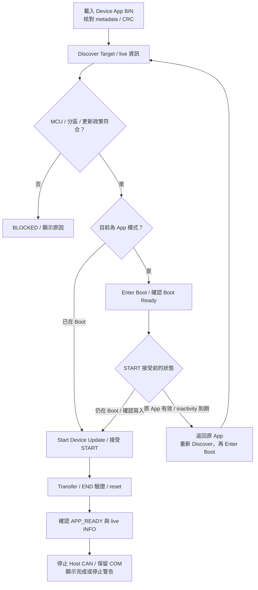
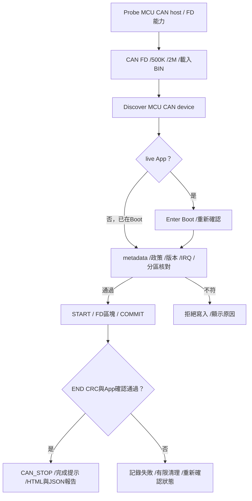

[知識庫首頁](https://released.github.io/) · [Simple Renesas ISP Tool 與 MCU bridge 操作](index.html)

# CAN／CAN FD App 更新

Classical CAN：F13／F24；CAN FD：F24。

## MCU CAN device：App 更新

F13、F24 device 各自提供獨立的 Boot／App 工程。
Tool 使用同一組 CAN Upgrade 操作，依實際 BIN 與 live device 的 metadata 核對 MCU 與更新條件。

BIN size 包含尾端 CRC，capacity 則為可用 App 區域。
App Start 使用 BIN metadata；手動 override 作為額外核對值。

<!-- TOOL_DEVICE_MEDIA_BEGIN -->

> **重要：預設 App 容量為 F13 119 KiB、F24 247 KiB，均保護 Flash 最後 1 KiB。**
> **若工程改為用滿 120／248 KiB，Boot 只能以 RFP 安裝；使用 CS+ Debug 下載 Boot 後做滿容量更新，可能導致 App 異常。**
> 配對工程設定、monitor 位址及安裝步驟見 [Boot 燒錄方式與 Flash 尾端保護](https://released.github.io/slide_boot_loader_for_RL78/#device-debug-monitor)。

### Device App 更新操作圖

先完成 Host Probe，在 CAN 頁選取 `CAN Upgrade`、Bridge port 與 device 使用的 bitrate。
以下圖片使用 F13 (MCU CAN device)，各欄數值來自所載入 BIN 與 live device；操作順序依回報模式選擇。
F13 與 F24 device 的正常 CAN App 更新皆已完成實板驗證，使用相同的載入、探索、進 Boot、更新及 App 確認流程。
F24 的完成報告與執行畫面見 [F24 device 更新結果](#f24-device-update-example)。
完整[欄位與狀態判讀](https://released.github.io/slide_simple_renesas_isp_tool/#tool-ui-fields)集中於 Tool operation。

#### 1. 載入 Device App BIN

`Load Update Image` 選取 `RL78_F13_Boot_loader_CAN_app_update.bin`，核對 MCU、App version、Metadata VALID 與 CRC MATCH。
此時尚未 Discover，LIVE 資訊為 N/A；離線驗證通過不代表已與 device 連線。

#### 2. Discover Target

`Discover Target` 讀取目前模式、Boot 與 installed App 資訊。
圖中為 `APPLICATION MODE`，下一步是 Enter Boot；若回報 `BOOTLOADER MODE`，直接進入步驟 4。

#### 3. Enter Boot 與操作等待時間

按 `Enter Boot`，等 DEVICE TARGET 回報 `BOOTLOADER MODE` 與 prerequisite 的 Ready。

F13 Boot 在**原 App 有效、ENTER 後尚未接受 START**時，若連續約 **30 秒沒有符合接收條件的 CAN request**，會返回原 App。
這是 inactivity 計時，不是 ENTER 後固定等待 30 秒；符合條件的 INFO 等 request 也會刷新計時。
在確認視窗停留過久，裝置也可能已返回 App，無法直接開始更新。

此時重新 `Discover Target`；若為 App 模式，再 `Enter Boot`，確認目前仍在 Boot 後執行 `Start Device Update`。
畫面先前取得的 Boot 資訊不是持續連線保證。
原 App 無效、START 已接受或錯誤處理後的行為，見 [Boot 逾時與更新狀態](https://released.github.io/slide_boot_loader_for_RL78/#f13-boot-decision)，不沿用此「返回原 App」條件。

#### 4. 確認並開始更新

按 `Start Device Update`，核對確認視窗的 MCU、檔案、版本、size、CRC 與改寫範圍，再確認寫入。
若出現狀態已改變、Boot 未就緒或 timeout，依步驟 3 重新取得目前模式，再確認更新條件。
Tool 在真正更新前會重新讀取模式；`Device is no longer in Boot; update not started.` 表示沒有開始更新，需重新 Discover／Enter Boot。

#### 5. 更新進行中

觀察階段、progress 與 Log。保持供電及 CAN 連線；`Cancel` 取消目前工作，`Close COM` 會取消並結束連線。
START 已接受後失聯不會沿用步驟 3 的自動返回原 App 行為；取消、錯誤與不完整映像的處理見 Boot 狀態章節。

#### 6. 更新完成與 App 確認

只有 END／CRC 通過、APP_READY 與 live INFO 核對完成後，才顯示 `[COMPLETE]` 與 Device App update complete。
正常完成會停止 Host CAN、保留 COM（Host UART），讓使用者檢查 App 與板上功能；因此 DEVICE TARGET 回到 N/A 並要求再次 Discover 是完成清理後的狀態。
App 未確認或 CAN STOP 未確認時，依[完成提示與下一步](https://released.github.io/slide_simple_renesas_isp_tool/#update-completion)處理，不自動重寫。
Tool 自動保存 Firmware update report；右下 `MESSAGE LOG` 的 `Open Last Report` 可開啟報告，操作見[更新報告](https://released.github.io/slide_simple_renesas_isp_tool/#update-html-report)。

### F24 (MCU CAN device)：更新結果與 App 執行

F24 device 已確認可完整執行正常 CAN App 更新：配對 Boot 驗證映像、寫入 App、
END／CRC 通過、reset 後回報 APP_READY，Tool 再核對 live INFO 並停止 Host CAN。
操作沿用上方六個步驟，載入檔案改為 `RL78_F24_Boot_loader_CAN_app_update.bin`，
並核對 F24 device 自己的 MCU、target、Flash 配置與 IRQ ABI。

#### 更新報告

HTML 報告的 `PASS | CAN device update` 與 `[COMPLETE]` 表示寫入、CRC 及 App 啟動確認均完成，
不以進度到達 100% 單獨判定成功。圖中 Host Link 為 115200，CAN 為 Classical 500K。

| 報告項目 | 判讀方式 |
| --- | --- |
| `Target before operation` | 更新前的 device 模式與已安裝 App；不是更新後版本 |
| `Input bytes` | 此次載入並傳送的 App BIN 長度，與 Flash capacity 分開 |
| `App version / Build / Image bytes` 比對 | 完整 HTML 的 live 值與載入 BIN 相符，代表重啟後辨識到此次 App |
| `CAN stopped; Host COM remains open` | App 確認後停止 CAN、保留 Host COM；下一次更新先重新 Discover |

開啟方式、完整欄位與錯誤判讀集中於 [更新報告](https://released.github.io/slide_simple_renesas_isp_tool/#update-html-report)。

#### Device UART 執行紀錄

UART 畫面顯示 `boot-validated`、`CAN update: completed`，以及 `log(timer)-V1` counter 從 0 持續遞增。
這份紀錄與 Tool 的 APP_READY／live INFO 一起確認 App 已啟動、timer 與主迴圈持續運作。
V1 是可編輯的觀察標籤，不取代 metadata 的版本號；修改位置見 [App 執行標籤](https://released.github.io/slide_boot_loader_for_RL78/#device-app-runtime-log)。

以上確認正常 115200 Host Link／500K CAN 更新與 App 執行。
250K／1M、長時間壓力、其他 IRQ、取消、拔線及斷電復原各自依 [實板驗證矩陣](https://released.github.io/slide_simple_renesas_isp_tool/#update-confirmation) 保留測試結果。
<!-- TOOL_DEVICE_MEDIA_END -->

### 更新速度與紀錄

每64-byte區塊使用一次 ACK，raw frame 每次攜帶最多8 bytes。
更新耗時由映像大小、Host Link／CAN 速度、Flash 與 trace 負載共同決定。

量測時保存 BIN、介面速度、耗時、CRC、retry／error／overflow counters。
封包與 Flash 處理細節集中於以下逐層導讀。

<!-- FD_UPDATE_BEGIN -->

## CAN FD App 更新操作

此設定使用 nominal 500 kbit/s、data 2 Mbit/s、BRS，以及 64-byte FD 資料幀。
Tool 與 MCU CAN host 負責傳輸，MCU CAN device Boot 負責映像驗證與 Flash 寫入。
F24 CAN FD device 的一般 App 寫入、END CRC、APP_READY 與 UART counter 已有實板紀錄。
驗證包含初次 Boot 更新，以及 App → Enter Boot → 更新 → App 確認；
重啟等待後的更新紀錄中，七項 Host 錯誤計數差值均為零。
長時間連續更新、queue 壓力與故障／斷電恢復仍各自保留驗證範圍。

### 準備與設定

| 項目 | 核對內容 |
| --- | --- |
| PC Tool | 使用支援 FD burst 的 FirmwareUpgradeTool |
| MCU CAN host | F24 Bridge App 宣告 CAN FD bit1 與 FD burst bit13；Host Boot 維持原有版本 |
| MCU CAN device | 配對的 CAN FD Boot／App；初裝 Boot 使用燒錄器 |
| Bus | 實際 transceiver、分析儀、供電、共地及終端適用於此 FD 設定 |
| Tool CAN TAB | CAN FD、Nominal 500K、Data 2M；Standard request0x700／response0x701 |
| 更新 BIN | `RL78_F24_Boot_loader_CAN_FD_app_update.bin`，metadata mode2、nominal mask4、data mask2 |
| PC 到 Host Link | 可先用115200；此速度與 CAN nominal／data phase 分開設定 |

若 host 缺少 bit13，Tool 在寫入前拒絕更新。
使用 [Misc Host App 更新](https://released.github.io/slide_simple_renesas_isp_tool/#host-bridge-firmware)
載入 `RL78_F24_Bridge_app_bridge_update.bin`，完成後明確 RUN、重新 Probe 核對能力。
此流程更新 Host App，不改 Host Boot。

### 操作順序與結果

| 順序 | 操作 | 核對結果／未符合時 |
| --- | --- | --- |
| 1 | Open + Probe Host | Host 身分及能力有效；失敗時先檢查 COM／Host Link |
| 2 | CAN FD／500K／2M，載入 FD update BIN | Metadata／CRC 有效，介面與 live device 設定一致 |
| 3 | Discover Target | 顯示 live Boot 或 App；無回覆時檢查兩端 FD timing／接線 |
| 4 | live App 時按 Enter Boot | 重新確認 Boot；已在 Boot 時不需 ENTER |
| 5 | Start Device Update | metadata／政策／版本／IRQ／分區通過才進行區塊寫入 |
| 6 | 等待 END 與 App 確認 | 全映像 CRC、APP_READY 與 live 身分比對通過 |
| 7 | 閱讀完成提示及 Firmware update report | CAN_STOP ACK 後清除 target session，保留 Host COM |

接收使用 RXMB0 中斷與 8 筆 RAM queue；Boot／App 向量與 Flash 交接詳見
[FD device 接收與中斷](https://released.github.io/slide_boot_loader_for_RL78/#can-fd-device-rx)。
實板核對時保留 Tool Log、Firmware update report 與 device UART Log，分別確認：

| 階段 | 可觀察結果 |
| --- | --- |
| Boot 安裝／Discover | 使用 programmer 安裝 Boot HEX；Tool 顯示 live Boot、FD 模式與相符的 MCU／分區 |
| App 更新 | 載入 FD App update BIN；metadata／CRC／路由核對通過後才開始更新 |
| END 與 App 啟動 | Tool 確認 APP_READY 與 live 版本／build／size；UART 顯示 `CAN update: completed` |
| App 接收路徑 | UART 顯示 `CAN RX: RXMB0 interrupt -> RAM queue=8 -> main; vector=0x4C`，並持續輸出 V1／V2 counter |
| 再次更新 | 再次 Discover App → Enter Boot → 更新；若 ENTER 已逾時回 App，重新 Discover／Enter Boot |

有效 App 的 ENTER session 在 START 前使用30秒 inactivity。
若已返回 App，重新 Discover → Enter Boot，再開始更新；開始寫入後逾時不會直接跳入未完成映像。
START 本身不擦除 Flash，區塊 COMMIT 驗證通過後才由 Flash driver 寫入。

報告及成功／失敗欄位沿用 [更新確認與驗證紀錄](https://released.github.io/slide_simple_renesas_isp_tool/#update-confirmation)。
END 後的等待與查詢時序見 [重啟等待與 App 確認](https://released.github.io/slide_simple_renesas_isp_tool/#app-restart-confirmation)；
完成提示與報告同時保留映像驗證結果及 Host 計數警告。
Metadata 的逐欄內容見 [共用欄位指南](https://released.github.io/slide_simple_renesas_isp_tool/#tool-ui-fields)，
不以離線 BIN 資訊代替 live device 身分。

### 三幀區塊與 Host Link

每個區塊最多64個有效映像 bytes。
控制與 ACK 也使用 FD+BRS；控制 payload 保留各命令原有長度。
下列 LE 值皆為 little-endian，offset 以 App BIN 開頭為0。

| CAN ID／payload | Byte位置 | 意義 |
| --- | --- | --- |
| 0x700 BEGIN，8 bytes | 0 | 0x0B |
| 同上 | 1..3 | 區塊 offset，LE24、64-byte對齊 |
| 同上 | 4..7 | 實際有效區塊資料的 CRC32 |
| 0x720 DATA，64 bytes、wire DLC15 | 0..N-1 | N=min(64,image_size-offset) 個映像 bytes |
| 同上 | N..63 | 尾塊不足64時固定補FF；Boot逐byte檢查，不計入區塊 CRC |
| 0x700 COMMIT，8 bytes | 0／1..3／4..7 | 0x0C／相同offset／相同CRC |
| 0x701 ACK，8 bytes | 0／1／2..3／4..7 | 0x0C／status／LE16區塊序號／LE32下個絕對寫入address |

完整區塊使用 BEGIN8 + DATA64 + COMMIT8，共3幀。
Host Link command22 的 version2 將它們放入101-byte payload，仍低於128-byte上限。
Header12 bytes之後，每筆為 LE16 standard ID、wire DLC、decoded-length data；
version2 的所有幀及預期回覆均為 FD+BRS，header byte9固定0x0C。
此擴充僅接受 DLC0..8 或15（64bytes）；Classical version1／bit12保持原有格式。
Host 只解碼與傳輸幀，不解讀 BEGIN、Flash address 或 device metadata。

同一區塊可因明確逾時／CRC／sequence結果有限重送。
Boot接受相同資料的重複幀，拒絕衝突幀，最近已提交區塊的重送不會再次寫入。
線路中斷後不自動續寫；重新連線並確認 device 狀態後再操作。
### 更新流程總覽

<!-- FD_UPDATE_END -->

---

[上一主題：欄位、更新確認與報告](status-and-reports.html) · [指南入口](index.html) · [下一主題：CAN 更新逐層導讀](can-protocol.html)
