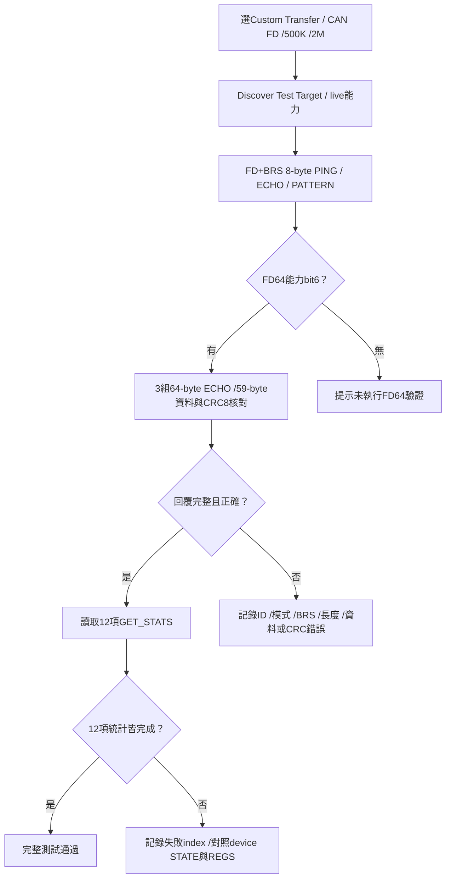
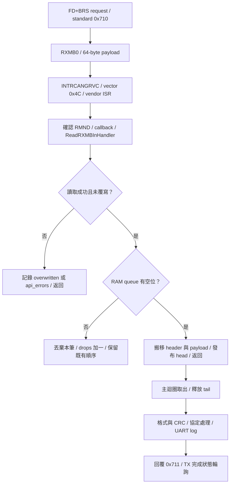

[知識庫首頁](https://released.github.io/) · [Simple Renesas ISP Tool 與 MCU bridge 操作](index.html)

<a id="article_top"></a>

# Custom Transfer 通訊驗證

F13／F24／RH850 Classical CAN，以及F24／RH850 CAN FD的獨立通訊測試。

<a id="custom-transfer"></a>

## Custom Transfer：MCU CAN device 通訊驗證

<!-- TRANSFER_EXAMPLES_BEGIN -->
Custom Transfer 搭配 device 的獨立 Transfer 工程。
測試包含 DEVICE_INFO、PING、ECHO、PATTERN、STATS，過程不擦寫 App Flash，也不使用更新 BIN。

### CAN_Transfer 範例分類

| MCU device／模式 | 範例原始碼 | Tool 設定 | 操作與對照 |
| --- | --- | --- | --- |
| F13 Classical CAN | [RL78_F13_CAN_Transfer](https://github.com/released/RL78_F13_CAN_Transfer) | Classical CAN／500K | [F13 量測範例](https://released.github.io/slide_simple_renesas_isp_tool/#f13-transfer-example) |
| F24 Classical CAN | [RL78_F24_CAN_Transfer](https://github.com/released/RL78_F24_CAN_Transfer) | Classical CAN／500K | [F24 操作與截圖](https://released.github.io/slide_simple_renesas_isp_tool/#f24-custom-transfer-example) |
| F24 CAN FD | [RL78_F24_CAN_FD_Transfer](https://github.com/released/RL78_F24_CAN_FD_Transfer) | CAN FD／500K／2M、BRS | [CAN FD 操作與中斷接收](https://released.github.io/slide_simple_renesas_isp_tool/#can-fd-custom-transfer) |
| RH850 Classical CAN | [工程與 EVM 接線](https://released.github.io/slide_boot_loader_for_RH850/can-device.html#rh850-can-device) | Classical CAN／500K | Device 啟用 CAN1／CAN4，依實際接線逐一測試 |
| RH850 CAN FD | [工程與 FD 設定](https://released.github.io/slide_boot_loader_for_RH850/can-device.html#guide-can-device-5) | CAN FD／500K／2M、BRS | 使用 FD Transfer，核對 8-byte 命令及 64-byte ECHO |

### Classical CAN 操作

1. 燒錄 device Transfer 工程並上電。
2. Tool 選擇 Custom Transfer、Classical500K。
3. 按 `Discover Test Target`，核對回覆的 part／target／protocol。
4. 按 `Transfer Test`。
5. 使用 PC log、device UART TRACE 與 analyzer trace 比對 sequence、command、payload、CRC 及 counters。
6. `Export Summary` 匯出結果。

Request 使用 standard `0x710`，response 使用 `0x711`，DLC8。
Payload Byte7 為 CRC-8/ATM。

<!-- TRANSFER_EXAMPLES_END -->

<!-- TRANSFER_DIAGNOSTICS_BEGIN -->
<a id="transfer-diagnostics"></a>

### Custom Transfer 診斷

Device UART（P15／P16，115200）的啟動與錯誤訊息，可對照初始化、CAN 連線及封包處理。

| Device UART 欄位 | 意義與核對方式 |
| --- | --- |
| `CAN init: OK/FAIL`、`result` | CAN 初始化結果；`0x0000` 表示成功，非零值依各 MCU driver 定義 |
| `global_status`／`channel_status` | F24 controller 原始狀態；保留完整值供診斷，不與 F13 的狀態數值直接比較 |
| `stage` | F24 初始化階段；`5` 表示 ready，未完成的 `1..4` 見下表 |
| `CAN config` | 編譯設定：Classical 500K、request `0x710`、response `0x711`、filter `0x710/0x7FF` |
| `STB=P12_LOW/HIGH` | MCU 的 P12 output latch；成功後應為 LOW，初始化失敗維持 HIGH。這不是供電或腳位電壓量測 |
| `TRACE CT RX/TX` | ID、DLC、完整資料、sequence、command 與 CRC；TX 表示 driver 接受傳送，不等於已收到 CAN ACK |
| `TRACE CT CAN_ERROR` | 已擷取的 Classical CAN 錯誤旗標與名稱；重複故障期間最多每 250 ms 輸出一次 |

| F24 stage 1..4 | 檢查位置 | 未通過時的核對方向 |
| ---: | --- | --- |
| 1 | driver configuration | 保留 result，核對 SC 與 clock／CAN 設定 |
| 2 | ID／global／channel reset state | 核對 request ID 與 controller raw status |
| 3 | start communication | 核對 driver result 與 mode transition |
| 4 | communication active | 等待有界；逾時回報 WAITING，核對 controller／bus 狀態 |

F24 的 `clock status: OK` 表示時鐘初始化檢查通過，不是頻率量測。
若時鐘初始化未通過，程式保留 standby，且不使用尚未符合 clock 設定的 UART 輸出。

GET_STATS index 7／8／9 分別是 warning／error-passive／bus-off 擷取計數，index 11 是最後擷取的錯誤旗標。
F13 由 error ISR 擷取；F24 由主迴圈輪詢並清除已觀察旗標，不在 ISR 格式化文字。
硬體旗標可能合併多次事件，計數表示軟體擷取次數；counter 飽和於 `0xFFFF`。
`CLEAR_STATS` 會重設統計，因此零次紀錄不等於已量測到沒有實體錯誤。

比對封包時開啟 Tool 的 `Detailed trace (slower)` 與 Log，另存 device UART 與 analyzer trace。
量測速度時將 device 的 `CAN_TRANSFER_UART_TRACE_ENABLE` 設為 `0U` 後重建，並關閉 Tool detailed trace；
錯誤擷取與 GET_STATS 仍運作。
完整 byte／command／counter 定義見 [通訊測試協定](https://github.com/released/simple_renesas_isp_tool/blob/main/docs/F13_TRANSFER_PROTOCOL.md)。
<!-- TRANSFER_DIAGNOSTICS_END -->

Analyzer 可送出 DEVICE_INFO page0：
ID `0x710`，資料 `A5 01 01 01 00 00 00 DC`。
F13 範例回覆為 ID `0x711`、`5A 01 01 01 00 01 00 8D`。
其他 page 由 Tool discovery 依序讀取。

<a id="f13-transfer-example"></a>

### F13 Classical CAN Transfer 量測範例

<figure><figcaption>CAN analyzer 的 request／response 與 error counter。</figcaption></figure>

<figure><figcaption>MCU UART 的 sequence、command、payload 與 CRC 訊息。</figcaption></figure>

<!-- CUSTOM_TRANSFER_MEDIA_BEGIN -->
<a id="f24-custom-transfer-example"></a>

### F24 (MCU CAN device)：Custom Transfer 操作範例

範例使用 `RL78_F24_CAN_Transfer`，Classical CAN 500K，request／response 為 `0x710／0x711`。
操作畫面與 MCU UART 可對照 discovery、測試命令及結果；點選圖片可開啟原尺寸。

畫面上方保留的 F13 App BIN 屬於 **OFFLINE** 檔案資訊，Custom Transfer 不使用此 BIN。
實際連線的 device 以 **DEVICE TARGET** 的 live 回覆為準；此例為 `R7F124FP`、target `0xF24B`。
Custom Transfer 不回報 Boot／App metadata，對應 LIVE INFO 顯示 `N/A` 是此模式的正常狀態。

#### 1. Tool：選擇通訊測試

Host 連線完成後，CAN 頁選擇 `Custom Transfer`、Classical 500K，再執行 `Discover Test Target`。

[](images/custom_transfer/CAN_custom_transfer_1.png)

圖：Host 已連線、device 尚未探索。此模式使用通訊測試命令，更新按鈕不啟用。

#### 2. MCU UART：Discovery 回覆

`DEVICE_INFO` 的 sequence 1..7 依序回覆 protocol、target、part prefix 與 capabilities。
圖中的 RX／TX 分別是 `0x710／0x711`，各筆顯示 `crc=OK`；target page 的 `4B F2` 為 little-endian `0xF24B`。

[](images/custom_transfer/CAN_custom_transfer_mcu_log_1.png)

圖：Device discovery 的 CAN request／response，可核對相同 sequence、command、payload 與 CRC。

#### 3. Tool：Transfer Test 完成

探索完成後，DEVICE TARGET 顯示 `R7F124FP / 0xF24B / protocol 1.0`。
執行 `Transfer Test` 後，Log 顯示 `Custom Transfer test completed successfully`，進度為 100%。

[](images/custom_transfer/CAN_custom_transfer_2.png)

圖：正常通訊測試完成。Log 的 `F24 counters: CAN RX=22, TX=22` 是 **MCU host** 的統計；
`Custom Transfer statistic[index]` 則來自 **MCU device** 的 GET_STATS 回覆。

#### 4. MCU UART：測試命令與統計

Sequence 8..22 可對照 PING（`0x02`）、ECHO（`0x03`）、PATTERN_TEST（`0x04`）與 GET_STATS（`0x05`）。
UART 圖中各筆 request／response 均顯示 `crc=OK`，可與 Tool 結果交叉核對。

[](images/custom_transfer/CAN_custom_transfer_mcu_log_2.png)

圖：Device 的測試命令與統計回覆。Counter 定義與判讀見 [Custom Transfer 診斷](#transfer-diagnostics)。

這組操作紀錄呈現正常 discovery／通訊測試；不包含 CAN 波形量測、故障注入、斷線恢復或 Boot／App 擦寫驗證。
<!-- CUSTOM_TRANSFER_MEDIA_END -->

<!-- FD_TRANSFER_BEGIN -->
<a id="can-fd-custom-transfer"></a>

## CAN FD Custom Transfer 通訊測試

Custom Transfer 驗證 MCU CAN host 與 MCU CAN device 的收發，不使用更新 BIN，也不擦寫 Flash。
FD 範例使用 `RL78_F24_CAN_FD_Transfer` 獨立整機映像，由燒錄器安裝。
此映像包含自己的 SC 工程與 `hal/can` 後端，由燒錄器安裝為獨立 Transfer 程式。

接收使用 RX Message Buffer 0（64-byte 容量）與中斷，資料經 8 筆 RAM queue 交給主迴圈。
Standard 0x710／mask 0x7FF 的規則只儲存到 RXMB0；接收 FIFO 不啟用，TX 完成狀態仍由主迴圈輪詢。
啟動訊息為 `CAN RX backend: RXMB0 interrupt -> RAM queue=8 -> main; payload=64 TX=polling`。
ISR、queue 與主迴圈的分工見[中斷接收路徑](#can-fd-transfer-rx-interrupt)。

### 操作與核對

| 步驟 | 設定／操作 | 核對結果 |
| --- | --- | --- |
| 1 | 燒錄 `DefaultBuild/RL78_F24_CAN_FD_Transfer.hex` | UART115200 顯示 `FD 500K/2M BRS payload=8/64` 與 CAN init OK |
| 2 | Tool Open + Probe Host | Host 支援 CAN FD、standard ID及通用 TX_WAIT_RX；F24 Host App1.7.0可使用 |
| 3 | CAN TAB → Custom Transfer | BIN與metadata不參與此測試；上方保留的OFFLINE檔案不代表live target |
| 4 | CAN FD、Nominal500K、Data2M、RX Filter Metadata/default | standard request0x710／response0x711、mask0x7FF |
| 5 | Discover Test Target | 讀取7頁DEVICE_INFO，顯示live target與capabilities |
| 6 | Transfer Test | PING／ECHO／PATTERN、3組FD64 ECHO及12項統計通過 |
| 7 | Disconnect | 結束CAN session後可選其他設定 |

既有 Classical device 使用 Classical CAN 與其已編譯速率。
FD mode不會讓Classical firmware自動支援FD；測試時匯流排上的節點需適用於所選幀格式與速率。
Bridge Self Test是另一項Classical功能，與 `Transfer Test` 的FD64驗證分開。



### 幀格式與能力

Discovery、PING、ECHO、PATTERN與統計維持8-byte payload，在FD mode使用FDF=1、BRS=1。
Classical命令與格式維持原有行為。
FD64能力由device的DEVICE_INFO page6 bit6（0x0040）宣告；完整範例capabilities為0x007F。
沒有此能力時，Tool不會將僅完成8-byte測試當作64-byte測試通過。

| 64-byte FD payload位置 | Request | Response |
| --- | --- | --- |
| byte0 | A5 | 5A |
| byte1 | 協定major1 | 同request |
| byte2 | 非零sequence | 同request |
| byte3 | ECHO_FD64 command07 | 同request |
| byte4..62 | 59個測試資料bytes | 完整回傳相同資料 |
| byte63 | CRC8-ATM，涵蓋byte0..62 | CRC8-ATM，涵蓋response byte0..62 |
| CAN frame | standard0x710、FDF/BRS、wire DLC15 | standard0x711、FDF/BRS、wire DLC15 |

CRC8-ATM使用poly0x07、init0、無reflection／xorout。
Tool測試遞增、反向與AA/55交錯三種資料；每幀實際payload為64bytes，包含5bytes協定欄位與59bytes測試資料。
Device對相同request重送保留完整回覆；相同sequence卻不同資料、CRC錯誤或無效64-byte格式會計數並丟棄。
Tool對模式／BRS／ID／DLC／sequence／資料／CRC不符回報失敗；等待與重試維持有限上限。
UART trace區分 `wire_dlc=15 bytes=64`，並列出完整資料。
測吞吐量時可關閉device UART trace與Tool detailed trace，正常測試則保留以利對照。

<a id="can-fd-transfer-rx-interrupt"></a>

### 中斷接收路徑

| 執行位置 | 工作 | 對應程式／設定 |
| --- | --- | --- |
| 硬體接收 | standard 0x710 寫入 RXMB0，產生 INTRCANGRVC | `add_rule()`；RMNB=0x0701、RMIEC=0x0001；實體 vector 0x4C |
| Renesas ISR | 擷取來源並確認／清除 RMND，再呼叫 callback | `r_can_glb_rxmb_isr()`；`CAN_CFG_INTRCANGRVC_USE=1` |
| Callback | 呼叫 InHandler，搬移完整 header／payload，最後發布 queue head | `my_can_glb_rxmb_callback()`、`R_CAN_ReadRXMBInHandler()` |
| 主迴圈 | 取出 queue，核對幀格式、協定、CRC，處理 request／reply 與 UART log | `Device_CanRead()`、`CAN_TransferProtocol_Process()` |

ISR 已先處理 RMND，因此 callback 使用 `R_CAN_ReadRXMBInHandler()`。
此 API 負責 RAM window 保存／還原及讀取期間的覆寫檢查；ISR 不解析協定、不輸出 UART，也不等待 TX。
主迴圈只消費 RAM queue，不以 polling 直接讀取 RXMB0。



RAM queue 可保存 8 筆完整訊息；實作用 9 個槽位區分空與滿。
ISR 是唯一 producer，主迴圈是唯一 consumer，完整複製後才交接槽位。
queue 滿時丟棄新到訊息，累計 `drops`；不覆寫尚未處理的資料。
RXMB0 本身仍只有一個硬體訊息位置；讀取期間的硬體覆寫與 RAM queue 滿載分別計數。
此配置屬於獨立 Transfer 映像；更新工程的接收設定見[FD device 工程](https://released.github.io/slide_boot_loader_for_RL78/#can-fd-device-engineering)。

此 Custom Transfer 中斷接收配置已完成一般一問一答實板驗證。
此結果的範圍是通訊測試；Flash 更新、queue 滿載、持續流量與供電中斷分別驗證。

<a id="can-fd-transfer-diagnostics"></a>

### 逾時與 RXMB／TX 診斷

`Host returned TIMEOUT for command 0x21.` 代表 Host 已透過 UART 回覆 CAN 交易逾時。
它與 PC 沒有收到 Host UART 回覆的 `Host Link response timeout after retries.` 分開判讀。
Tool 保留原始錯誤，另顯示 `attempts`、`last_tx_result` 與失敗的 `GET_STATS index`。

| Tool 診斷 | 意義／核對方式 |
| --- | --- |
| `attempts=2` | Host 的 CAN 交易共嘗試兩次，包含第一次發送 |
| `last_tx_result=2 (TX_END)` | 最後一次 CAN TX 完成；不代表 device 軟體已取出或處理 request |
| `TRANSMITTING`／`ABORT_OVER`／`END_WITH_ABORT` | 發送未正常完成或包含 abort；與最後 CAN controller 狀態一起核對 |
| `invalid diagnostic payload` | 回覆長度或保留欄位不符，Tool 不將其解讀為有效 TX 結果 |
| `GET_STATS index=3` | 停在讀取 device 的 TX failure counter；不代表 counter 本身就是故障原因 |

Device 的 `CAN_TRANSFER_RUNTIME_DIAGNOSTICS_ENABLE` 預設跟隨 `CAN_TRANSFER_UART_TRACE_ENABLE`。
啟用時，初始化、每 16 筆接收、TX 異常會輸出 `TRACE CT STATE`、`TRACE CT IRQ` 與兩行 `TRACE CT REGS`。
沒有新接收時，每秒最多一組空閒快照，連續最多三組；有接收後重新計數。
空閒快照也會在正常等待操作時出現，不單獨代表錯誤。

| Device UART 欄位 | 意義 |
| --- | --- |
| `reason` | `INIT`、`RX_CHECKPOINT`、`IDLE_WAIT` 或具體 TX timeout／abort 原因 |
| `tick`／`seq`／`cmd` | device tick、最近收到的協定 sequence／command；不是 PC 時間 |
| `sw_tx` | 軟體狀態：0 idle、1 sending、2 aborting、3 fault；sending 快照可能只是尚未輪詢完成 |
| `rx`／`tx`／`last_driver`／`errors` | 軟體收發計數、最近 HAL 結果及已擷取的 CAN error flags |
| `RMNB` | RXMB 配置；本範例為 0x0701：1 個 RXMB、64-byte 容量 |
| `RMND` | 接收完成旗標；bit0=1 表示 RXMB0 有新訊息，由 vendor ISR 確認／清除 |
| `reads`／`overwritten` | 接收 API 成功次數／讀取期間偵測到的覆寫次數，皆為 16-bit 飽和的軟體觀察計數 |
| `before`／`after` | callback 內 InHandler 呼叫前後的 RMND；ISR 已先確認旗標，因此 `before=0` 正常 |
| `entries` | RXMB callback 次數；來源為零或尚未 ready 時不搬資料，不必與協定 RX 筆數相等 |
| `queued`／`dequeued` | 成功入列／主迴圈取出數；無待處理資料時兩者應相等，計數飽和後不再用差值判讀 |
| `depth`／`peak` | 當下待處理筆數／初始化以來最高筆數，範圍 0..8 |
| `drops`／`api_errors` | RAM queue 滿時丟棄的新訊息數／接收 API 其他錯誤或無效長度數 |
| `RMIEC`／`mask`／`pending` | RXMB 中斷允許位元、快照前 CPU mask、CPU request flag；正常啟動為 RMIEC=1、mask=0 |
| `window` | CAN RAM window 的原始讀值；RXMB0 資料經 page2 讀取，再還原原先視窗 |
| `TMC0`／`TMSTS0`／`last_tmsts` | 當下 TX 控制／狀態，以及 TX polling 在正常清除完成旗標前保留的原始值 |
| `GSTS`／`C0STSL`／`C0ERFLL`／`STB` | Global／channel 狀態、當下 error flags 與 transceiver standby 電位 |

快照在主迴圈暫時遮罩 RXMB 中斷，取得一致的 ISR 軟體計數後，還原原先 mask。
它不清接收旗標、不消費 queue、不 reset，也不自動重試。
硬體仍可在此期間接收，寄存器依序讀取；`before`／`after` 不單獨作為通訊完整性的證明。
ISR／InHandler 使用方式見 [Renesas RS-CANFD Lite 驅動說明](https://www.renesas.com/en/document/apn/rl78f24-rs-canfd-lite-module-software-integration-system)，接收寄存器見[接收緩衝區說明](https://www.renesas.com/en/document/apn/rl78f24-rs-canfd-lite-configuration-reception-and-transmission-rev100)。

遇到逾時時，保留 Tool detailed trace 與 device UART 的最後一筆 RX／TX、`STATE`／`IRQ`／`REGS`。
先對照 request 是否到達、RMND／reads／overwritten 是否改變、TX 是否完成，再決定處理方向。
UART 輸出會增加主迴圈延遲；吞吐量量測時可將兩個 trace 開關設為 `0U` 後重建。

連續測試可在同一連線重複執行 `Transfer Test`，核對每輪的 12 項統計均完成，並由 UART `rx` 觀察累計接收跨過 16、32、64 筆。
同一個 session 可持續接收；不依累計筆數重新初始化 RXMB0。
一般一問一答測試的 `drops`、`overwritten`、`api_errors` 應保持 0，取出後 `depth=0`，`queued=dequeued`。
若 `entries` 不增加，先核對 RMIEC／mask／pending 與實際向量；若 `entries` 增加但 `dequeued` 停住，則對照 queue 與主迴圈狀態。
重新上電時，先確認 device UART 已重新連線並開始記錄，再核對 `INIT`、`CAN init` 與 `STB`；LED 心跳本身不代表 CAN 已就緒。

### 工程與產物

FD Transfer 自備 `hal` 來源、header 與建置工具，可單獨建置，不需要 Boot checkout。
在FD Transfer目錄使用Windows PowerShell5.1：

```powershell
powershell.exe -NoProfile -ExecutionPolicy Bypass -File .\build.ps1
```

此入口只clean build FD Transfer，不重建Boot或App，不需要Python。
MTPJ的pre/post hooks引用FD helper；SC重新產生後使用同一入口重新prepare與建置。
正式產物為 `DefaultBuild/RL78_F24_CAN_FD_Transfer.hex`，供燒錄器安裝，不能載入CAN Upgrade。
安裝獨立Transfer會取代板端原有程式；燒錄前核對實際MCU、映像與erase範圍。
CRC／診斷欄位見 [Custom Transfer診斷](https://released.github.io/slide_simple_renesas_isp_tool/#transfer-diagnostics)。
一般中斷接收與 Transfer Test 已完成實板驗證；queue 壓力、波形及故障測試另行記錄。
<!-- FD_TRANSFER_END -->

---

[上一主題：UART／Xmodem／I2C 操作](serial-isp.html) · [指南入口](index.html) · [下一主題：MCU host 韌體與自身更新](host-firmware.html)
