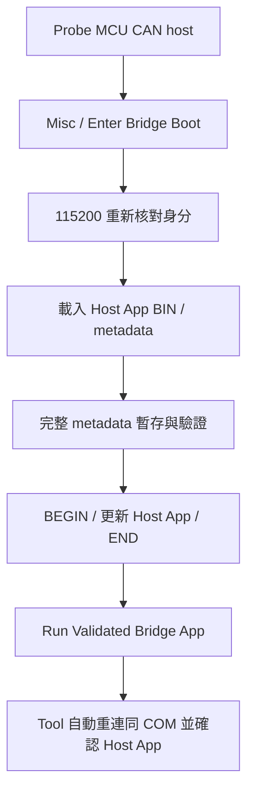
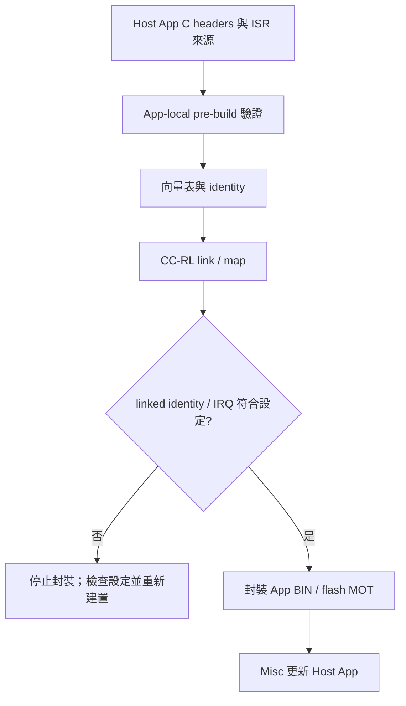

[知識庫首頁](https://released.github.io/) · [Simple Renesas ISP Tool 與 MCU bridge 操作](index.html)

<a id="article_top"></a>

# MCU host 韌體與自身更新

Misc／UART 更新 Host App，以及 Host 工程與向量設定。

<a id="host-bridge-firmware"></a>

## MCU CAN host：Misc／UART 更新 Host App

本節更新 PC 所連接的 host 自身 App，使用 host Boot 的 UART 更新介面。

1. Open + Probe Host，切換 Misc。
2. `Read Bridge Update Info` 讀取 host MCU、分區與 App 資訊。
3. `Enter Bridge Boot (UART)` 進入 Boot；Tool 依描述器以115200重連。
4. 載入 `*_bridge_update.bin`，核對 HOST APP、MCU、metadata 與 CRC。
5. `Update HOST APP` 確認後更新。
6. 完成後按 `Run Validated Bridge App`，Tool 自動重連並確認 App 資訊。



### Host 初次安裝

Boot 專用 MOT、燒錄器 App `_flash.mot` 與 Misc `_bridge_update.bin` 的檔名及下載集中於[交付檔與安裝範圍](#downloads)。
可先以燒錄器安裝 Boot，再透過 Misc 更新 App；或以燒錄器安裝配套 Boot 與 App MOT。

Host Boot 預留20 KiB，App 起點0x5000，最後1 KiB保留。
Host Boot 保持固定UART115200；一般 Host Link 連線速度見 [更新政策與通訊速度](#image-update-policy)。

<!-- TOOL_BRIDGE_MEDIA_BEGIN -->
<a id="bridge-update-example"></a>

### Host App 更新操作圖

以下使用 F24 (MCU CAN host)。Misc 更新的是 PC 所連接 host 自身的 App，固定以 UART115200 操作。
初裝 Boot MOT、燒錄器 App MOT 與 Misc BIN 的選用，見[下載與操作總覽](https://released.github.io/slide_simple_renesas_isp_tool/#downloads)。

#### 1. 載入 Host App BIN

選取 Misc，載入 `RL78_F24_Bridge_app_bridge_update.bin`。
核對目的地為 HOST BRIDGE、MCU、metadata、CRC MATCH 與 UART115200；Device App BIN 會因目的地不符而被拒絕。

[](images/tool_operation/tool_Bridge_update1_load_image.jpg)

#### 2. 確認 Enter Bridge Boot

按 `Read Bridge Update Info` 取得目前資訊，再按 `Enter Bridge Boot (UART)`。
確認視窗列出的 HOST BRIDGE、COM 與 MCU；此步進入 Boot，不擦寫 App。

[](images/tool_operation/tool_Bridge_update2_enter_boot.jpg)

#### 3. 確認 Host Boot 已連線

等 Tool 以同一 COM／115200 重新 Probe。
目的地回報 `HOST BRIDGE - BOOT mode`，且 prerequisite 為 Ready 後，才可更新。

[](images/tool_operation/tool_Bridge_update3_enter_boot.jpg)

#### 4. 確認並寫入 Host App

按 `Update HOST APP`，核對檔案、MCU、App start 與 size，確認後開始寫入。
保持 UART 與供電；Boot／option／保留區不在 Misc App 寫入範圍。

[](images/tool_operation/tool_Bridge_update4_start_update.jpg)

#### 5. 寫入完成，仍停留 Boot

`Host App update complete - RUN required` 表示映像寫入、CRC 與 metadata readback 通過，**還沒有啟動 App**。
下一步是明確執行 RUN，不需再次燒錄。
此次寫入結果會自動保存為 Firmware update report，可按 `Open Last Report` 查看；[報告操作](https://released.github.io/slide_simple_renesas_isp_tool/#update-html-report)說明儲存位置與判讀方式。

[](images/tool_operation/tool_Bridge_update5_after_update.jpg)

#### 6. Run Validated Bridge App

按 `Run Validated Bridge App`，核對 HOST BRIDGE 目的地後確認。

[](images/tool_operation/tool_Bridge_update6_run_valid.jpg)

#### 7. Host App 啟動確認

Tool 自動重連同一 COM，重新讀取並核對已安裝 App 資訊。
`Host App startup confirmed` 與 `[COMPLETE] Host App is running` 表示此階段完成；之後可選擇 CAN 等 device 介面。
若 Log 的 counter 顯示 unavailable，代表該次重啟前後無可比對的 snapshot，不等於此處的 App 更新失敗。
此時 `Open Last Report` 開啟的是本次 RUN 確認報告；先前的寫入報告仍保留於 `reports/`。

[](images/tool_operation/tool_Bridge_update7_update_finish.jpg)
<!-- TOOL_BRIDGE_MEDIA_END -->

### Recovery 入口

按住 SW1（P32 LOW）並 reset／重新上電，進入 host Boot。
Tool 以115200 Probe，確認 Boot 資訊後，使用上述 Misc 流程更新 App。

<!-- F24_APP_IRQ_BEGIN -->
<a id="host-app-engineering"></a>

### F24 (MCU CAN host)：App 工程

本節供需要閱讀或調整 host firmware 的開發者參考。

| 來源目錄 | 內容 |
| --- | --- |
| `firmware/RL78_F24_Bridge_boot` | Host Boot、UART recovery |
| `firmware/RL78_F24_Bridge_app` | Host App、Host Link dispatch、bus service |
| `firmware/f24_board` | 共用 board／driver／SC |
| `firmware/f24_bridge_common` | Host App 分區與自更新契約 |

#### 設定、解析與介面分工

Host App 擁有自己的 `app_image_config.h` 與 `app_irq_handlers.h`。
以 C header 編輯發行資訊與 IRQ mapping，Windows PowerShell／CS+ 負責產表與封裝。
MCU 建置不需要 Python 或 JSON 設定檔。

| 來源 | 職責 | 修改範圍 |
| --- | --- | --- |
| App 的 `app_image_config.h` | 版本、build、board ID、role、允許更新介面 | App 發行設定；身分與介面須符合 Boot 契約 |
| App 的 `app_irq_handlers.h` | `APP_IRQ_HANDLERS(X)` 對照 vector byte address 與 ISR | App 功能使用的中斷 |
| `f24_bridge_common/image_metadata_config.h` | MCU 身分、Flash 分區、Boot 版本、IRQ ABI、固定 UART | 工程配置；調整時核對 Boot／App、linker 與 backend |
| `f24_bridge_common/image_metadata_profile.c/.h` | 將工程配置組成 live descriptor 的預期值 | MCU／board profile，不操作 register |
| `common/bridge_image_metadata.c/.h` | BUR1／BUI1 欄位解碼、格式驗證及契約比對 | 可移植 C90 模組，不包含更新命令或 Flash driver |
| `common/bridge_update_contract.h`、`bridge_update_engine.c/.h` | 更新命令、狀態機與 Flash callback | 收包、staging、CRC 與更新時序 |
| `f24_bridge_common/boot_app_handoff.h` | recovery cookie 與 IRQ owner 的 no-init RAM 位址 | startup／linker／交接設定 |

Pre-build 產生 `bridge_vectors.asm`／`f24_app_identity.generated.h`。
Post-build 核對實際 linked App 身分、向量目的地及 RETI／RETB，再封裝更新映像。
單獨重新產生 header 不會改變已編譯映像的身分；不符時需重新建置。



#### 編輯 App metadata

在 App 專案開啟 `app_image_config.h`；每個 define 的註解包含用途、範例與修改條件。

| Define | 範例 | 判斷方式 |
| --- | --- | --- |
| `APP_IMAGE_VERSION` | `0x00010600UL` = 1.6.0 | `0x00MMmmpp`，各一 byte；非日期或十進位字串 |
| `APP_IMAGE_BUILD` | `20261017UL` | 發行識別，允許 0..0xFFFFFFFE |
| `APP_IMAGE_TARGET_ID` | `0x0101U` | 等於 Boot 的 board ID；單獨改為 `0xF33BU` 會停止產生 |
| `APP_IMAGE_ROLE` | `2U` = HOST BRIDGE APP | 本工程使用 2；`5U` 等未定義值會停止產生 |
| `APP_IMAGE_UPDATE_TRANSPORTS` | `0x04U` = UART | bitmap：CAN=0x01、I2C=0x02、UART=0x04；此契約要求 UART |

例如發行 1.6.1 時，只調整版本與 build，再 clean build App。
Boot 版本與 App 版本是各自的發行身分，不要求數值相同。
Host App 的版本用於識別；更新仍依 board／分區／相容性與 CRC 判斷。

Misc 更新 UART 固定 115200，來源是 `image_metadata_config.h`。
App 執行時的 Host Link 115200／460800／921600、CAN bitrate 與 I2C speed 不會改寫這項更新契約。
Magic、core／region 長度與 policy 格式由 `bridge_image_metadata.h`／`image_policy.h` 定義；App 發行時維持格式契約。

#### 編輯 App IRQ mapping

在 App 的 `app_irq_handlers.h` 加入 `X(vector, handler)`。
Vector 是硬體 vector 的 byte address，來源為此專案的 `iodefine.h` 中斷定義及 MCU 硬體手冊的 Interrupt Functions 表。
例如 `INTST0=0x16` 對應表內的 UART send ISR；slot 位址為 `0x5000 + 0x16 × 2 = 0x502C`。

新增一般中斷時，將 ISR C 檔加入 App MTPJ，再於 X-macro 加入對應項目：

```c
/* Example INTP0 mapping; initialize its flag/mask/pin separately. */
X(0x08, app_aux_irq)
```

ISR 使用 global、無 `vect=` 的 interrupt pragma，並由編譯器產生 RETI。
Pre-build 檢查合法 vector、重複項目、實際登錄來源與 ISR 定義，產生完整 64-slot 表。
未列入的正常 IRQ 使用 default ISR；硬體初始化、旗標與 mask 仍由 App 配置。
固定向量介面內新增 mapping 不需修改 Boot 或 linker 的表長度。

#### 移植 metadata C 模組

| API | 輸入 | 成功表示 |
| --- | --- | --- |
| `Bu_ParseManifest(p, length, &manifest)` | 至少 128 bytes 的 BUR1 core | core 欄位及 geometry 格式合法 |
| `Bu_ParseMetadataRegion(p, length, &manifest)` | 完整 256 bytes | core 合法且後 128 bytes 全為 FF |
| `Bu_ParseInfo(p, length, &info)` | 至少 96 bytes 的 BUI1 descriptor | live descriptor 格式合法 |
| `Bu_MatchesDevice(&manifest, &info)` | 已解析的兩份資料 | board、MCU、分區、UART、IRQ ABI 與 minimum Boot 相符 |

Parse API 檢查 null／可用長度並回傳 1 或 0；失敗時不使用 output。
以 byte buffer 解碼 little-endian 欄位，無需將 wire buffer 強制轉型成 C struct。
編譯環境需提供 8-bit `uint8_t`、16-bit `uint16_t` 與 32-bit `uint32_t`；現有工程由 toolchain 的 `stdint.h` 提供。
`Bu_Read16/32`、`Bu_Write16/32` 是已確認 2／4-byte 範圍後使用的低階 helper。
格式與契約相符不代表完整映像 CRC、簽章或可啟動；完整 CRC 與執行條件由更新引擎及 Boot 檢查。

移植時將 metadata C 檔單獨加入 Boot／App 的編譯來源，保留 `image_policy.h` 格式定義。
以自己的 config／profile 提供 MCU 契約，再接上更新引擎的 Flash callback、UART 收包及 linker／startup。
只有 backend 使用該 MCU 的 register／Flash library；metadata parser 不引用這些介面。

#### App-only 建置

1. 建立自己的 App 工程，保留 MTPJ、startup、兩份 C header 與來源登錄。
2. Pre-build 使用 `prepare_f24_app_irq.ps1 -AppProject "."`。
3. Post-build 使用 `package_f24_bridge.ps1 -Kind app -AppProject "."`。
4. 在 Tool root 執行對應 App 的建置：

```powershell
.\scripts\build_f24_bridge.ps1 -Kind app -AppProject ".\ProjectA"
```

封裝輸出 `<專案名>_bridge_update.bin` 與 `<專案名>_flash.mot`。
產表與封裝會核對 App mapping、BR 目的地及 RETI／RETB。
更新操作集中於 [Misc／UART](https://released.github.io/slide_simple_renesas_isp_tool/#host-bridge-firmware)。

#### Smart Configurator

SC 設定為 `firmware/f24_board/f24_board.scfg`。
搬移或重新產生 SC 後，以 `prepare_f24_bridge_projects.ps1 -Kind app` 整理 App 的相對路徑與來源登錄，再建置 App。
Host Boot 的硬體設定調整時，另以 `-Kind boot` 整理及建置。
<!-- F24_APP_IRQ_END -->

---

[上一主題：Custom Transfer 通訊驗證](custom-transfer.html) · [指南入口](index.html) · [下一主題：MCU device 工程入口](device-guides.html)
