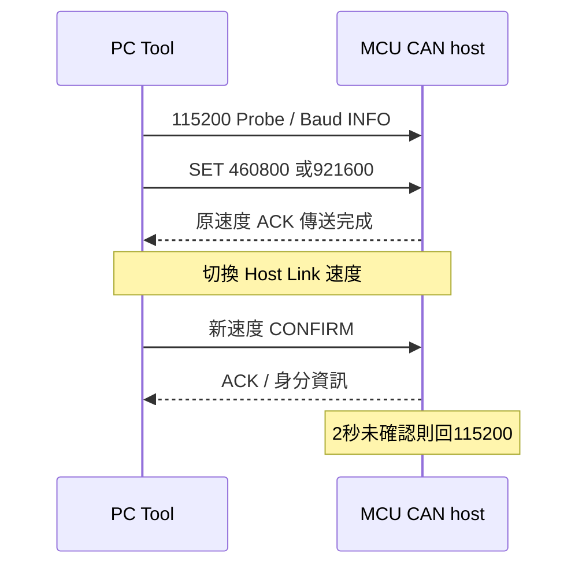
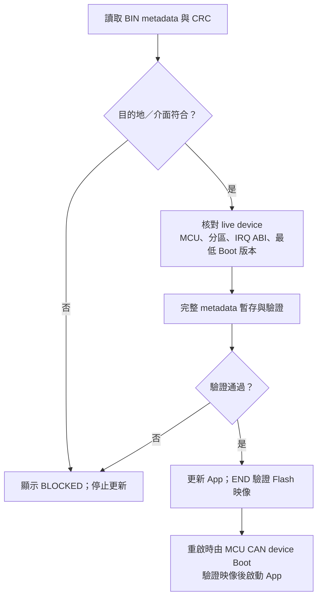

[知識庫首頁](https://released.github.io/) · [Simple Renesas ISP Tool 與 MCU bridge 操作](index.html)

# Tool 連線與操作

COM／Host 識別、畫面、接線、更新政策與錯誤資訊。

## Tool 連線與主畫面

1. `Refresh` 後選取 `COMx: Windows friendly name`。
2. 選擇 Host Baud，按 `Open + Probe Host`。
3. 核對 HOST BRIDGE 卡片的 MCU、board ID 與 firmware 資訊。
4. 在 CAN／I2C 頁選擇 host 回報的 Bridge port。
5. 功能是否可執行，會顯示於狀態列及 prerequisite 區。

`Reset Host` 重新啟動 host；`Disconnect` 結束 bus／target 連線；`Close COM` 結束 UART 連線並取消工作。
COM friendly name 用於選擇介面，MCU 身分由 Probe 回覆取得。

<!-- TOOL_CONNECT_MEDIA_BEGIN -->

### COM 連線操作圖

選擇 COM 與 Host Baud 後按 `Open + Probe Host`，核對 `HOST BRIDGE | VERIFIED LINK` 與實際 MCU。
下圖的 COM 已驗證，但 Misc 仍保留 Device CAN BIN，因此出現 `INVALID - HOST APP required`；連線成功與選檔相容是兩項獨立判斷。
進行更新前，依[下載與操作總覽](https://released.github.io/slide_simple_renesas_isp_tool/#downloads)載入對應目的地的 App BIN。

圖中的版本、COM 與大小是操作範例；本機檔案與報告路徑已遮蔽，狀態與操作結果保留。
網頁上的操作圖可點選開啟原尺寸，方便查看欄位與訊息。

<!-- TOOL_CONNECT_MEDIA_END -->

### 五張資訊卡

| 資訊卡 | 內容 | 來源 |
| --- | --- | --- |
| HOST BRIDGE | Host MCU／COM／firmware／能力 | Host Link |
| DEVICE TARGET | Device MCU／target／目前模式 | Device live INFO |
| BOOT CODE | Boot version／build／分區 | Live INFO |
| INSTALLED APP | 板上 App version／build／大小 | Live INFO |
| LOADED APP BIN | 檔案 version／build／MCU／大小／CRC | 離線 BIN |

畫面使用 Windows 系統灰白底與加粗群組邊框；綠色表示條件符合，黃色表示等待／政策提示，紅色表示錯誤或 BLOCKED。
卡片同時顯示文字；滑鼠停留時可閱讀完整內容。

主畫面保留12項metadata；`BIN Details...`可查看全部20項。欄位、正常／錯誤訊息與處理方式集中於 [欄位與狀態判讀](#tool-ui-fields)。
其中也分開說明離線 BIN 與 live 裝置資料，以及 CAN／Misc／I2C 的顯示差異。

最上方為 Host 連線，次上方為 BIN／裝置資訊；下方分成周邊設定、載入／更新映像、Message Log。
底部顯示進度與耗時，只有 Log 歷史和下拉選單捲動。
群組間的資料關聯見 [畫面群組](#tool-console-layout)；Log 的 [Auto scroll down](#tool-log-auto-scroll) 預設啟用，可記憶於 INI。
切換介面後沿用同一份映像與 log，live 資訊則依目前連線重新取得。

### 接線與介面參數

| 項目 | 設定 |
| --- | --- |
| PC ↔ host UART | TX／RX 交叉、共地，預設115200 |
| F24 MCU CAN host | CAN P10 TX／P11 RX／P12 STB；UART P15 TX／P16 RX |
| CAN bus | CAN H／L、共地、兩端終端電阻、相同 bitrate |
| F13 device EVB | X1 4MHz、CAN16MHz；TJA1050T VCC 5V、S LOW |
| F24 device Target Board | X1 4MHz、CAN40MHz；接線依該板原理圖 |
| I2C | IICA0 P62／P63、100kHz，pull-up 電壓依 slave 規格 |

終端電阻以斷電狀態量測。
CAN analyzer 設定與 bus bitrate 一致；active 節點提供 ACK。

### Bridge Board Self Test

1. Probe Host，選定 CAN port，保持 CAN stopped。
2. 選取 host 支援的 Classical CAN 250K／500K／1M，analyzer 使用同一速率。
3. 按 `Start Bridge Board Self Test`；旁邊 `?` 提供 analyzer 提示。
4. 觀察 standard ID `0x123`、DLC8、`11 22 33 44 55 66 77 counter`。
5. Counter 每次啟動從00開始，每秒遞增，FF後回00；按 Stop 結束。

此功能驗證 host TX 路徑。Device 端收發見 [Custom Transfer 通訊驗證](custom-transfer.html)。

## 連線與錯誤資訊

| 現象 | 對應檢查 |
| --- | --- |
| Host Link timeout | COM、UART 接線、Host Baud、host firmware |
| Clock error | 晶振、SC 與 runtime clock |
| CAN bus error | transceiver 供電、STB、共地、H／L、終端、bitrate／ACK |
| Request 無 response | device firmware、filter、ID、RX／TX 路徑 |
| Metadata／CRC error | App 工程與載入 BIN |
| CRC MATCH但按鈕未啟用 | prerequisite、live mode／layout、busy 狀態 |
| Misc 無更新能力 | Host live capability／Boot 描述器 |

完整故障矩陣涵蓋重送、取消、斷線、reset、斷電與 Flash error；實板結果由各工程記錄。
CRC 驗證用於映像完整性，詳細政策如下。

<!-- COMMON_IMAGE_POLICY_BEGIN -->

## 更新政策與通訊速度

BIN metadata 提供更新目的地、允許介面、MCU 身分與 Boot 契約。
版本政策與密碼確認的維護操作集中於 [force 降版](https://released.github.io/slide_simple_renesas_isp_tool/#force-old-version)。
Tool 將這些欄位與目前選定的 port、live device 資訊一併核對。

| UI 資訊 | 來源與作用 |
| --- | --- |
| Update Policy | App 目的地及允許 CAN／I2C／UART 更新的清單 |
| Boot / IRQ ABI | 映像所需的最低 Boot 版本、固定向量介面 |
| MCU、版本、分區、CRC | 載入 BIN 的離線資訊 |
| LIVE INFO | 目前連線裝置回報的資訊 |

選定介面與映像政策不同時，Tool 保留 BIN 原有資訊並顯示 BLOCKED。
UI、worker 與 device Boot 分別執行對應驗證；改變 port／address／rate 後會重新探索。

Metadata 位址與欄位格式見 [Device 映像對照](https://released.github.io/slide_boot_loader_for_RL78/#flash-metadata-can-reference)。

### 三條通訊路徑的速度

| 路徑 | 設定來源 | 目前設定 |
| --- | --- | --- |
| PC ↔ MCU CAN host 的 Host Link | Tool Host Baud 與 host live 能力 | 上電115200，可協商460800／921600 |
| MCU CAN host ↔ MCU CAN device | device Boot／App 編譯設定與 metadata | Classical CAN 500K |
| PC ↔ host Boot 的自身 App 更新 | host Boot 描述器 | Misc／UART115200 |

Host Link 換速完成後會重新確認 host 身分。
尚未確認時，host 在2秒內回到115200；已確認後維持該次連線速度。

Device 改為 250K／1M 時，依 [Device CAN 速率配置](https://released.github.io/slide_boot_loader_for_RL78/#device-can-bitrate)
同步修改 driver timing、Boot／App 的速率契約並重建安裝；Tool 下拉選單只設定 host，不改變 device。

### 更新前的核對路徑

CRC提供完整性檢查。映像驗證與實板功能測試分別記錄。
Device UART metadata 的 `device_uart_baud` 由 Boot／App 編譯設定決定，獨立於 Host Baud。
<!-- COMMON_IMAGE_POLICY_END -->

---

[上一主題：下載與韌體產物](downloads.html) · [指南入口](index.html) · [下一主題：欄位、更新確認與報告](status-and-reports.html)
