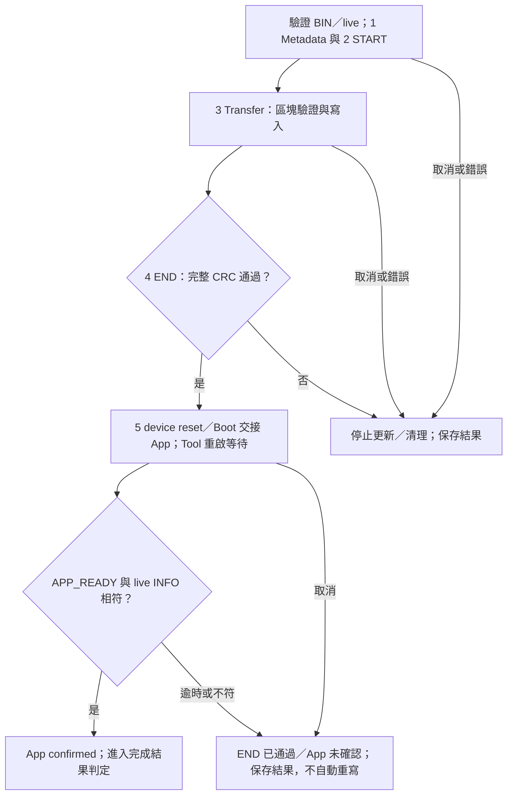
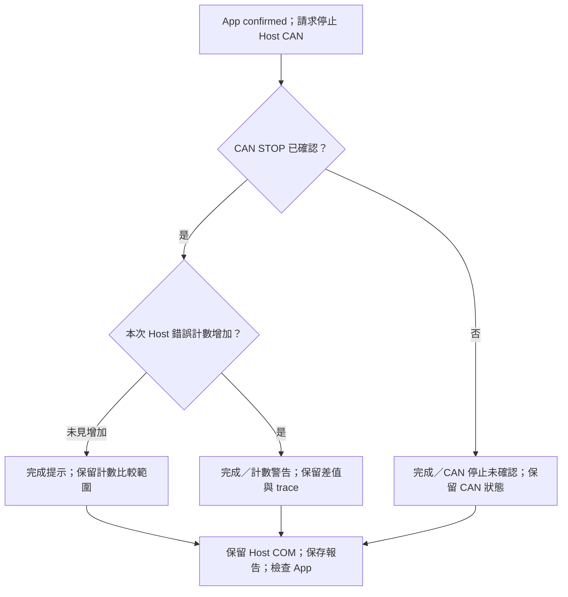

[知識庫首頁](https://released.github.io/) · [Simple Renesas ISP Tool 與 MCU bridge 操作](index.html)

<a id="article_top"></a>

# 欄位、更新確認與報告

BIN／live 資料、狀態訊息、進度、取消及 HTML 更新報告。

<!-- UPDATE_EVIDENCE_BEGIN -->
<a id="update-confirmation"></a>

## 更新確認、差異表與報告

更新流程把「資料已寫入」與「App 已開始執行」分開記錄。
CAN device 更新完成後由 Tool 自動確認 App；Misc 的 RUN 仍由使用者明確執行。
[MD 原稿](https://github.com/released/simple_renesas_isp_tool/blob/main/docs/UPDATE_VALIDATION_zh-TW.md)／
[PDF](https://github.com/released/simple_renesas_isp_tool/blob/main/docs/UPDATE_VALIDATION_zh-TW.pdf)提供離線說明與測試表。

| 操作 | 成功條件 | 未確認時 |
| --- | --- | --- |
| CAN Start Device Update | metadata、START、所有區塊及 END CRC 通過；同一路 CAN 收到 APP_READY，再取得 live INFO，版本／build／實際大小與載入 BIN 相符 | 顯示 END 已完成但 App 未確認；不自動重寫 |
| Misc Update HOST APP | 完整映像 CRC、有效標記與 256-byte metadata readback 通過 | 保留 Boot，顯示階段與原因 |
| Misc Run Validated Bridge App | RUN 只送一次；Tool 自動在同一 COM、115200 重連，核對相同 board ID、APP mode、完整 metadata、版本／build／大小 | 顯示 RUN 未確認；不重送 RUN、不自動擦寫 |
| Compare Metadata | 開啟 Loaded image／Live device 差異表 | 未取得 live 資訊時不以 BIN 補成 live |
| Verify Installed | CAN device 停留 Boot、無更新 session；重新計算已安裝映像 CRC，核對尾端 CRC | 回報 metadata／CRC／狀態錯誤，不擦寫 |

重連等待有時間與次數邊界，可由 Cancel 結束。
CAN 確認沿用現有 Host Link 與 CAN 路由，不會重新掃描其他 COM。
版本等摘要與健康回覆是目前執行的韌體回報，不是簽章或功能完整性的認證。

<a id="app-restart-confirmation"></a>

### 重啟等待與 App 確認

END CRC 通過後，Tool 依新 App BIN 大小與本次 END CRC 實測耗時，安排 1～6 秒的重啟等待，再開始 APP_READY 唯讀查詢。
等待期間不送出 CAN 請求，不切換 COM 或重送 END；Cancel 仍可結束確認流程。
這段等待包含在原有 12 秒的探測期限內，後續未就緒的查詢間隔至少 100 ms。
單次通訊仍有自身的逾時邊界；等待值不是所有 App 的最長啟動時間保證。

大小估算 S：將 App BIN bytes 除以 1024、向上取整，再乘以 8 ms。
更新後等待為 `max(S, END CRC ms) + 500 ms`，限制在 1000～6000 ms。
每 KiB 8 ms 是現有範例的保守排程基準；較慢的實測 END CRC 可提高等待值，並非 MCU 效能規格。

`Enter Boot` 後則以 live INFO 的「目前已安裝 App 大小」估算 `2 × S + 500 ms`，同樣限制在 1～6 秒。
此段預留兩輪檢查，不使用即將更新的新 BIN 大小；未知已安裝大小時使用 6 秒。
兩種等待均以最多 20 ms 的短段檢查 Cancel。

例如，假設 END CRC 耗時不高於 S：120 KiB 更新後等待 1460 ms、Enter Boot 後等待 2420 ms；
247 KiB 分別為 2476 ms 與 4452 ms。實際值以 Log 與報告為準。

排程定義見 [等待時間原始碼](https://github.com/released/simple_renesas_isp_tool/blob/main/src/core/app_confirmation_timing.h)。
這項設定不修改 CAN／UART 交易逾時、重試次數或 Device 的 CRC／啟動檢查，也不隱藏通訊計數。

`phases_ms.app_confirmation` 包含重啟等待及 App 確認耗時。
`details` 的 `app_reset_quiet_ms` 與 `app_health_probes` 分別記錄等待設定及實際健康查詢次數。
逾時、取消或 live 資訊不符時，保留 END 已通過的事實，不自動重寫映像。

### 寫入與啟動確認流程



### 完成結果與計數判定流程



<a id="update-completion"></a>

### 完成提示與下一步

可計量階段的百分比表示該階段進度；等待回覆或 App 重啟時顯示動態等待條與 `waiting...`。
完整更新條件通過後，Tool 顯示一次完成對話框，並在狀態列與共用映像區保留 `[COMPLETE]` 及下一步操作。
開始其他作業、切換 TAB 或載入檔案後，畫面回到目前操作的條件判定；歷史結果可從 Log 與報告查看。
斷線後重新執行 `Open + Probe Host` 時，進度條與階段標籤歸零；不沿用上次的 100%。
同一連線內的狀態更新不會清除正在執行的進度；`Open Last Report` 仍可查看本次開啟 Tool 後保存的報告。

| 操作結果 | 畫面提示 | 下一步 |
| --- | --- | --- |
| CAN device 更新且 App 啟動確認通過 | `Device App update complete`；CRC／App 已確認，Host CAN 停止，COM 保留 | 可檢查 App code 與板上功能；再次更新時重新 Discover Target |
| App 已確認、CAN 已停止，但本次 Host 錯誤計數增加 | `Device App updated / Host counter warning`；黃色 `[COMPLETE / WARNING]` | 更新成功；查看報告的 counter 差值與 detailed trace，不以重寫 App 清除警告 |
| App 啟動已確認，但 Host CAN STOP 未確認 | `Device App updated / CAN stop not confirmed`；黃色 `[COMPLETE / WARNING]` | 更新已成功，CAN 可能仍在運作；查看 Shared Log，使用 Disconnect／Close COM 清理後再調整介面，不以重寫 App 處理停止警告 |
| Misc Host App 寫入與驗證通過 | `Host App update complete - RUN required`；Host 停留 Boot | 按 `Run Validated Bridge App`；若按鈕不可用，先 Read Bridge Update Info／Probe Host |
| Misc 明確 RUN 並重連確認通過 | `Host App startup confirmed`；同一 COM、board 與已安裝映像核對完成 | 可檢查 Host App 或切換至 device 介面 |
| 已 END，但 App 未確認、操作失敗或取消 | 保留原始錯誤／取消結果；不顯示更新成功對話框 | 依階段、Log 與報告檢查；不自動重寫或重送 RUN |

CAN 在 APP_READY 與 live INFO 核對完成後才停止，不在 Transfer 100% 或 END ACK 當下停止。
這裡停止的是 Host CAN controller，不是關閉 COM、切斷 device 電源或停止 App 執行。
停止後清除當前 live target 快照；上方卡片須經下一次 Discover 才重新取得資訊，完成結果則保留於狀態區。
App 啟動確認涵蓋必要初始化與映像身分，板上的應用功能仍可另行檢查。

#### Discover Target 與 Enter Boot

`Discover Target` 是唯讀探索，在 Boot 或支援更新協定的 App 模式都可執行，不限於尚未安裝 App 的裝置。
`Enter Boot` 則是已探索的 App 切入 Boot 的明確操作；探索到 Boot 時不需要再次 ENTER。

| 裝置目前狀態 | 畫面指引 | 操作順序 |
| --- | --- | --- |
| 尚未 Probe Host | `Next: Open + Probe Host, then Discover Target.` | Probe → Discover |
| 已 Probe，尚未 Discover | `Next: Discover Target (available in Boot or App mode).` | Discover → 依回報模式繼續 |
| Discover 回報 Boot | `Boot mode detected. Enter Boot is not needed` | 核對 BIN／條件 → Start Device Update；有無已安裝 App 都依實際模式判斷 |
| Discover 回報 App | 粗體黑字 `Next: Enter Boot. App mode detected` | Discover → Enter Boot → 核對 BIN／條件 → Start Device Update；進入 Boot 或作業執行中時，回復一般提示 |

App 的 INFO／ENTER 回覆由該 App 實作。
若自行開發的 App 未提供更新協定，可使用專案定義的 reset／recovery 方式停留 Boot，再 Discover；Tool 不以未回覆推定裝置已進入 Boot。
完整操作入口見 [MCU CAN device 更新](https://released.github.io/slide_simple_renesas_isp_tool/#mcu-can-device)。

<a id="tool-ui-fields"></a>

### Tool 欄位與狀態判讀

畫面上的資訊分為離線 BIN、目前連線裝置與本次操作設定。
`LOADED APP BIN | OFFLINE` 與共用映像區大多來自檔案，不代表板上已安裝相同內容。
`Device LIVE policy` 則來自已探索的裝置；尚未取得的 live 資訊不以 BIN 補入。
五張資訊卡的位置與來源見 [主畫面](https://released.github.io/slide_simple_renesas_isp_tool/#tool-operation)。

<a id="tool-console-layout"></a>

#### 畫面群組與資料關聯

畫面使用 Windows 系統灰底、白色資料欄與加粗群組邊框。
資訊來源以標題、同色系邊框與 `OFFLINE`／`LIVE` 文字區分；綠、黃、紅仍表示判定結果。

| 來源識別 | 同色系區塊 | 資料來源 |
| --- | --- | --- |
| 藍灰 | HOST BRIDGE | Probe讀回的bridge身分／能力 |
| 青綠 | DEVICE TARGET、DEVICE BOOT、DEVICE APP | 所選device的即時INFO；三張卡屬於同一device |
| 米褐 | 第二排的LOADED APP BIN及右側三個BIN群組 | 載入檔案的metadata／CRC，不代表已寫入device |

Misc更新的live卡片屬於bridge，會一併使用Host藍灰識別。
`Device LIVE policy` 有明確LIVE標籤，是下方欄位中來自裝置的政策；其餘BIN欄位以檔案解析為主。
來源色不表示成功或失敗；紅色錯誤底與狀態側條仍保留，避免來源與驗證結果混用。

| 群組 | 位置與用途 | 資料關聯 |
| --- | --- | --- |
| 1. HOST CONNECTION | 最上方；COM、Host Baud、Probe、Close、Reset 與 Cancel | PC ↔ bridge 的連線；先 Probe 才取得 Host 身分與周邊能力 |
| 2. INFORMATION | 第一排是Host／Device／Boot／App即時資訊；第二排是Loaded BIN及精簡metadata | 即時板端回覆與載入檔案獨立核對 |
| 3. PERIPHERAL / TARGET | 左下；CAN／I2C／UART / Xmodem／Misc、port、速度、ID／位址及探索操作 | 決定通訊路徑與目前目標；TAB 僅涵蓋此群組 |
| 4. LOAD / UPDATE IMAGE | 中下；載入 BIN、App Start、Compare Metadata、Preflight 與更新 | 載入後，群組 2 顯示解析結果；前置條件與完成後下一步顯示於此 |
| 5. MESSAGE LOG | 右下；訊息、檔案紀錄、報告、詳細 trace 與自動捲動 | 記錄操作過程；可暫停跟隨新訊息來閱讀歷史內容 |

| 第二排群組 | 主畫面欄位 |
| --- | --- |
| BIN check / layout | CRC Result、Metadata Status、App Range、Image / Capacity |
| BIN interface / policy | Interface / Rate、Routing / IDs、Update Policy、Protocol / Format |
| BIN compatibility / LIVE policy | Boot / IRQ ABI、BIN Version Policy、Device LIVE policy、Flash / Boot |

Loaded BIN卡提供MCU、版本、build及檔案大小；下方的 `BIN Details...` 開啟唯讀視窗，保留全部20項欄位、完整檔案路徑及目前Workflow的檢查結果。
卡片使用四行摘要；過長的單行或額外內容以省略號表示，滑鼠停留可查看全文。
包含Calculated／Stored CRC、Target、Minimum／Erase等細節；不需連線，也可查看不符合目前路由的BIN。
`Device LIVE policy`仍明確標示為裝置來源，不以離線BIN補成live資料。
操作執行中暫停開啟詳情，不中斷worker或發送通訊命令。

[逐欄說明](#tool-ui-metadata)列出各欄位的意義。
較長的主畫面值可停留滑鼠查看全文；live差異與操作條件分別使用Compare Metadata／Preflight。
主視窗不使用上下捲軸，只有 Log 歷史與下拉清單捲動；最小視窗高度依字型尺寸調整。

<a id="tool-log-auto-scroll"></a>

#### Message Log 自動捲動

`Auto scroll down` 位於 Message Log 操作區，預設勾選，與 `Detailed trace (slower)` 分開設定。

| 設定 | 新訊息到達時 | 閱讀方式 |
| --- | --- | --- |
| 勾選 | 每次追加訊息後顯示最底部 | 持續查看最新訊息；重新勾選時也立即回到底部 |
| 取消勾選 | 訊息照常追加，保留目前捲動位置與選取文字 | 可往上閱讀或複製；新訊息不會拉動畫面 |

設定儲存在 EXE 旁的 `FirmwareUpgradeTool.ini`，重開 Tool 沿用：

```ini
[ui]
log_auto_scroll=1
```

`1` 表示跟隨，`0` 表示暫停跟隨；沒有此設定時預設啟用。
這個選項只控制視窗，不停止通訊、不取消操作，也不影響已啟用的檔案 Log 紀錄。
`Detailed trace` 控制詳細訊息量；`Start Log`／`Stop Log` 控制檔案紀錄，三者用途各自獨立。

#### 連線、介面與載入欄位

| 欄位／操作 | 用途 | 正常顯示／選擇 | 未符合時的判讀與處理 |
| --- | --- | --- | --- |
| COM／Open + Probe Host | 選擇 PC 到 bridge 的連線，讀取 Host 身分與能力 | `COM6: USB Serial Port (COM6)`；Probe 後 HOST BRIDGE 為 `VERIFIED LINK` | friendly name 不是 MCU 身分；未驗證或逾時時先核對 COM、電源、占用程式與 Host Baud |
| Host Baud | PC 與 Host Link 的 UART 速度 | `115200`、`460800`、`921600`，依 Host 能力協商 | 不等於 CAN bitrate 或 device 更新 UART；Misc 更新固定 `115200`，詳見 [通訊速度](https://released.github.io/slide_simple_renesas_isp_tool/#image-update-policy) |
| Bridge port | 使用 Host 實際回報的周邊 port | Probe 後選擇列出的 port | `N/A - Probe bridge first` 表示尚未取得能力，不是從 MCU 型號推測 port |
| CAN Mode／Nominal／Data | 本次 CAN 模式、仲裁段與資料段速度 | `Classical CAN`／`500K`／`N/A` | Classical 的 Data 為 `N/A` 是正常；模式、速度須同時符合 Host、BIN 與 device，改 Tool 不會改 device Boot 的編譯設定 |
| RX Filter／ID／Mask | Host 接收回覆的篩選條件 | `Metadata/default`，或符合回覆 ID 的自訂 filter | 接收錯 ID 可能造成逾時；自訂 mask 不得為零。這是接收 filter，不會改寫 BIN 裡的 request／response ID |
| Workflow | 選擇更新或通訊測試 | 更新用 `CAN Upgrade`；通訊驗證用 `Custom Transfer` | Transfer 不使用更新 BIN，也不提供 Boot／App metadata；操作見 [Custom Transfer](https://released.github.io/slide_simple_renesas_isp_tool/#custom-transfer) |
| Load Update Image／Update image | 讀入檔案並顯示實際路徑 | CAN 載入 `_update.bin`；Misc 載入 `_bridge_update.bin` | 路徑可用來確認選檔，但檔名不是驗證依據；HEX、MOT、未封裝 BIN 或不同角色的映像不能只改副檔名使用 |
| App Start Override | CAN 更新起點的額外一致性檢查 | `Auto` 使用 BIN metadata 的起點 | 手動值須與 BIN 起點一致；不會搬移映像、重建向量或改寫 metadata。Misc 不開放此欄位 |

<a id="tool-ui-status"></a>

#### 狀態文字與顏色

顏色只代表該欄位的判定範圍；一般數值欄位不會逐一與 live 值比較後變紅。
實際差異與未滿足條件可從 `Compare Metadata`、`Preflight` 及 prerequisite 區查看。

| 顯示文字／位置 | 顏色 | 代表意義 | 後續查看 |
| --- | --- | --- | --- |
| `VALID`／Metadata Status | 綠 | CAN 映像的格式、欄位與配置檢查通過；不包含 CRC 相符或 live 裝置相容的保證 | 同時看 CRC Result、Update Policy 與 Preflight；Misc 判定範圍見 [介面差異](#tool-ui-adapters) |
| `INVALID (see log)`／Metadata Status | 紅 | CAN metadata 不符合映像契約；部分欄位會維持 `N/A` | Shared Log 的原始原因；不要以尚未顯示的數值當成零 |
| `MATCH`／CRC Result | 綠 | 計算值等於檔案儲存值 | 仍須核對 metadata 與 live 裝置；CRC 不是來源認證 |
| `MISMATCH`／CRC Result | 紅 | 計算值與儲存值不同 | 核對檔案是否截斷、封裝後被修改，或選到非更新產物；重新建置並封裝 |
| `UNAVAILABLE`／CRC Result | 紅 | CAN 檔案不足以讀取尾端 CRC32 | 檢查檔案與大小，不進行更新 |
| `N/A`／資訊欄位 | 灰／中性 | 尚無資料、無法解析，或此操作不適用 | 依欄位來源判斷；不是零值，也不等於檢查通過 |
| `N/A - not verified`／HOST BRIDGE；`N/A - not discovered`／DEVICE TARGET | 等待／中性 | 尚未完成 Host Probe 或 device discovery | 先 Probe，再依 Workflow 探索目標；不以載入 BIN 的 MCU 取代 live 身分 |
| `BOOTLOADER MODE`／`APPLICATION MODE`／DEVICE TARGET | 已取得 live 資訊時依狀態顯示 | 裝置目前回報 Boot 或 App 模式 | 更新仍須滿足 Boot 與其他條件；模式本身不表示已驗證 Flash CRC |
| `N/A - not installed`／INSTALLED APP | 黃 | 裝置未回報有效的已安裝 App | 與尚未探索時的 `N/A` 區分；載入離線 BIN 不會改變此狀態 |
| `ENABLED \| same / newer`／版本政策 | 黃 | 已啟用同版或新版限制，是政策提示而非錯誤 | 分清 BIN 與 Installed；見 [版本維護](#force-old-version) |
| `DISABLED \| any version`／版本政策 | 綠 | 不限制版本順序 | CRC、MCU、分區、介面與 IRQ 等檢查仍有效 |
| `RECOVERY \| no valid App`／Installed Policy | 灰／中性 | live 裝置未回報有效 App 的版本政策 | 走映像與裝置驗證；沒有獨立保存的最低版本門檻 |
| `WRONG ROUTE`／載入映像卡 | 紅 | 載入的角色或允許介面與目前 TAB 不符 | 選擇正確 TAB／映像；切 TAB 不會轉換檔案格式 |
| `Ready:`／prerequisite | 綠 | 目前操作的前置條件已符合 | 可開始操作；不是已完成更新 |
| `[COMPLETE]`／狀態與共用映像區 | 綠；CAN 停止未確認時為黃色警告 | 更新／啟動核對已完成，保留本次結果與下一步 | 依 [完成提示](#update-completion) 檢查 App 或明確 RUN；不把下一次更新需要進入 Boot 當成這次失敗 |
| `Missing:`／prerequisite，或停用按鈕 | 黃；不相容時可為紅 | 缺少連線、Boot 模式、映像、能力或其他條件；作業執行中也會停用按鈕 | 先讀該區文字，再開 Preflight；不一定是 BIN 錯誤 |
| `[BLOCKED] Selected CAN mode/bitrate...`／前置條件區 | 粗體黑字、錯誤底色與邊框 | 已載入 BIN 不支援所選 CAN 模式或速率 | 依 `Check BIN supported...` 提示，核對 `Interface / Rate`、Device Boot 與 CAN 設定；相容後才顯示 Discover／Enter Boot 等下一步 |
| `Next: Enter Boot.`／前置條件區 | 粗體黑字、等待底色 | Discover 已確認 App 模式，且 Enter Boot 可操作 | 先 Enter Boot，再依 BIN／條件執行 Start Device Update；BIN 模式／速率不符時，優先顯示阻擋原因 |

`Update Policy` 與 `Boot / IRQ ABI` 的背景色目前表示映像角色／允許介面與所選 TAB 是否相符。
兩欄呈綠色不代表已與 live Boot 版本或 IRQ ABI 比對成功；實際契約比較見 [Metadata 差異表](#tool-metadata-comparison)。
狀態列的 `[WORKING]` 文字表示作業執行中，`[ERROR]`／紅色表示有原始錯誤可從 `Error Details` 再次查看。

<a id="tool-ui-metadata"></a>

#### BIN Details：20 項欄位參考

以下數值是判讀範例，不是所有 MCU 專案的固定值。
以一份 CAN device BIN 為例：檔案長 `8192` bytes，映像起點 `0x00002000`，最後一個 byte 位於 `0x00003FFF`。
CRC 範例 `0x12345678` 僅示意兩欄相等，不是這份示例的實測 checksum。

##### 檔案與完整性

| UI 欄位 | 資料來源與用途 | 顯示範例 | 判讀與處理 |
| --- | --- | --- | --- |
| BIN Size | 實際載入檔案長度，包含向量區、metadata、程式與尾端 CRC | `8192 bytes (0x00002000)` | 應與封裝結果及 metadata image size 一致；不是只計算程式碼的大小 |
| Calculated CRC32 | Tool 對檔案最後 4 bytes 之前的內容計算 CRC32 | `0x12345678` | 不含尾端儲存的 CRC32；與 Stored CRC32 比較，不是讀回板上 Flash |
| Stored CRC32 | 檔案最後 4 bytes 的 little-endian CRC32 | `0x12345678` | 由封裝產生；修改 BIN 內容後須重新封裝，不是手動填入任意相同數字 |
| CRC Result | 上述兩值的比較 | `MATCH` | `MISMATCH` 拒絕更新；`MATCH` 只代表檔案 checksum 相符，不代表適合目前裝置 |
| Metadata Status | 離線映像契約的檢查結果 | `VALID` | CAN 與 Misc 的判定邊界不同；`VALID` 仍須搭配目的地及 live 相容性檢查 |

##### 身分與格式

| UI 欄位 | 資料來源與用途 | 顯示範例 | 判讀與處理 |
| --- | --- | --- | --- |
| MCU | BIN 宣告的 MCU family／part | `RL78/F13 / R5F10BMG` | 與 DEVICE TARGET 的 live 身分分開；不一致時核對所選專案與目標板 |
| App Version | BIN 的 App major.minor.patch | `1.2.3` | 用於版本政策比較；不是目前板上版本，也不是 Boot 版本 |
| Build | BIN 的 build 識別值 | `20260101` | 日期是專案慣例；不以 build 大小決定能否降版 |
| Target | BIN 宣告的 target ID | `0x0000F13B` | 須符合裝置契約；不能只修改 ID 就將其他 MCU 的程式轉為可用映像 |
| Protocol / Format | 更新協定 ID.版本／映像格式／checksum 類型 | `1.5 / 6 / CRC32` | `1.5` 是協定 ID 與協定版本的組合，不是 App 版號或 CAN port；不符時核對工程配置與封裝流程 |

##### 映像範圍與 Flash 配置

| UI 欄位 | 資料來源與用途 | 顯示範例 | 判讀與處理 |
| --- | --- | --- | --- |
| App Range | 整份映像的起點／最後一個 byte 位址 | `0x00002000 / 0x00003FFF` | 結束位址為 start + image size - 1，包含尾端 CRC；不是 C 程式入口或整個可用分區的終點 |
| Image / Capacity | 本份映像大小／可用 App 映像容量 | `8192 / 121856 B` | 前者不得超過後者；Capacity 不是剩餘空間，兩者不必相等 |
| Flash / Boot | MCU code Flash 大小／Boot 保留大小 | `131072 / 8192 B` | 來自工程契約，不是目前 Boot 消耗量；須與 live 配置一致 |
| Minimum / Erase | 最小完整映像長度／Flash 擦除單位 | `516 / 1024 B` | 最小長度含向量、metadata 與 CRC；Erase 不是 CAN 資料區塊大小，也不是本次總擦除量 |

##### 更新介面、相容性與版本政策

| UI 欄位 | 資料來源與用途 | 顯示範例 | 判讀與處理 |
| --- | --- | --- | --- |
| Interface / Rate | BIN 允許的 CAN 模式與 nominal／data bitrate | `Classical; 500K / N/A` | 不是目前下拉選單值或 Host Baud；Classical 的 data rate 不適用。Misc 顯示其更新 UART |
| Routing / IDs | BIN 的 ID 格式、request／response ID | `STD 0x00000700 / 0x00000701` | 分別為更新請求與回覆，不是兩組 CAN port；與 Boot、接收 filter 及 live 契約核對 |
| Update Policy | BIN 的角色與允許更新介面 | `DEVICE APP \| CAN` | CAN BIN 切到 I2C／Misc 不會自動變成可更新；不相容時先確認目的地與編譯契約 |
| Boot / IRQ ABI | BIN 要求的最低 Boot 版本／IRQ 介面識別 | `1.0.0 / 0x31563146` | live Boot 須達最低版本，IRQ ABI 須相符；不要求 App 與 Boot 版號相等，數值與顏色不能取代 live 比較 |
| BIN Version Policy | 本份 BIN 安裝成功後採用的版本順序政策 | `ENABLED \| same / newer` 或 `DISABLED \| any version` | 不決定本次是否能降版；由目前有效 App 的 Device LIVE policy 決定 |
| Device LIVE policy | live device 回報的目前有效 App 政策 | `ENABLED \| same / newer`；未探索時 `Discover Target required` | 一般更新依此判斷；`RECOVERY \| no valid App` 與 `N/A` 不當成已取得 disabled 政策 |

欄位編輯與產生方式見 [App 設定與建置](https://released.github.io/slide_boot_loader_for_RL78/#device-app-config)。
每個 byte 的 offset／Flash address 與對應程式見 [Metadata 位址對照](https://released.github.io/slide_boot_loader_for_RL78/#flash-metadata-can-reference)。
本節只解讀畫面；更改顯示或檔名不會改變工程契約。

<a id="tool-ui-adapters"></a>

#### CAN、Misc 與 I2C 的顯示差異

共用畫面依辨識出的映像格式顯示資訊；即使選錯 TAB，仍可能讀出檔案身分，再由更新政策拒絕該路由。

| 操作範圍 | 格式與正常顯示 | 驗證範圍與不適用欄位 |
| --- | --- | --- |
| CAN device 更新 | CAN device manifest；CRC32；`DEVICE APP \| CAN` | `Metadata Status = VALID` 與 `CRC Result = MATCH` 是分開判定；兩者都通過後仍檢查 live 身分、分區、速度、IRQ 及版本政策 |
| Misc Host App 更新 | BUR1；`Bridge UART contract3 / BUR1`；`UART / 115200`；`PC -> HOST BRIDGE` | `VALID` 包含 BUR1 格式、配置、檔案長度與 CRC 檢查。`INVALID - HOST APP required` 也可能是長度／CRC 錯誤，須看 log。未辨識 BUR1 時 CRC 欄位可能為 `N/A`；兩個版本政策欄位不填入，`N/A` 不代表 disabled |
| I2C reference 原始 BIN 檢視 | `RAW BIN - no manifest`；欄名為 `Calculated CRC16`／`Stored CRC16`；可顯示 `MATCH (G16 reference)` | 無 manifest 時不從原始 BIN 推測 MCU、版本或 App 起點，也不把 live 值填入離線欄位。CRC16 相符不開放擦寫；目前為唯讀參考操作 |

I2C reference 使用 CRC16/XMODEM、初值 0，計算範圍不含檔案最後 4 bytes；儲存 CRC16 位於檔尾前 4 bytes 起的兩個 bytes，採 little-endian。
此範圍與 CAN／Misc 的尾端 CRC32 不同，不能交叉解讀 `MATCH`。
Misc 更新與明確 RUN 的操作見 [Host App 更新](https://released.github.io/slide_simple_renesas_isp_tool/#host-bridge-firmware)。

#### 常見組合與原始訊息

| 畫面組合／log 原文 | 意義 | 可核對的項目 |
| --- | --- | --- |
| `VALID` + `MISMATCH` | CAN metadata 通過，但檔案 checksum 不符 | 重新取得或封裝 BIN；不進行更新 |
| `MATCH` + `INVALID (see log)` | checksum 相符，但映像契約未通過 | 檔案種類、metadata 配置與 log 原因；CRC 不能取代格式檢查 |
| `VALID` + `MATCH`，更新仍停用 | 檔案通過離線檢查，仍可能缺少 live 條件或有相容性差異 | [Preflight](#tool-preflight)、[Metadata 差異表](#tool-metadata-comparison)與 prerequisite 文字 |
| `Selected CAN mode is not supported by the image.` | BIN 允許的模式與 Tool 選擇不符；例如 CAN FD BIN 搭配 Classical CAN | 依 `Check BIN supported CAN mode` 核對 BIN 的 `Interface / Rate`，載入與 Device Boot 及 CAN Mode 一致的 BIN；此時不接續顯示 Discover 指引 |
| `Selected CAN bitrate is not supported by the image.` | BIN 允許的 nominal／data bitrate 與選項不符 | 核對 BIN `Interface / Rate`、Device Boot 設定與所選速率；Tool 設定不會改變 Device Boot 的速率 |
| `App Start Override does not match image metadata (...)` | 手動起點與 BIN 不同；括號內為實際位址 | 回到 `Auto`，或使用與工程配置相符的值；不以此欄搬移 BIN |
| `CAN Upgrade image metadata magic is invalid.` | 映像識別值不符 | 是否載入正確的封裝產物，而不是 HEX、raw BIN 或其他角色映像 |
| `Image update policy is missing, malformed or unsupported.` | 更新角色／介面等 policy 無法通過解析 | App／工程 header、產生流程及封裝輸出 |
| `Firmware image length does not match its metadata.` | 檔案大小與宣告值不同，或未符合最小長度／4-byte 對齊條件 | 是否截斷、誤選產物、最小長度配置錯誤，或封裝後另有附加資料 |
| `Reserved metadata extension bytes must be 0xFF for this image format.` | 保留區不是契約要求的 `0xFF` | metadata 產生配置；不在保留區自行填資料 |
| `Firmware CRC32 trailer does not match the calculated CRC32.` | 尾端 CRC32 不符 | 重新建置／封裝，避免在產出 BIN 後直接修改內容 |

完整更新判定與資料傳遞見 [CAN 更新逐層導讀](https://released.github.io/slide_simple_renesas_isp_tool/#can-update-walkthrough)。
通訊與裝置回覆錯誤的分類見 [錯誤資訊](#tool-error-guidance)。
畫面欄位對應實作：[CAN 映像顯示](https://github.com/released/simple_renesas_isp_tool/blob/main/src/main_frame_image.cpp)、[狀態色彩](https://github.com/released/simple_renesas_isp_tool/blob/main/src/main_frame_status.cpp)、[Misc](https://github.com/released/simple_renesas_isp_tool/blob/main/src/main_frame_misc.cpp)、[I2C](https://github.com/released/simple_renesas_isp_tool/blob/main/src/main_frame_i2c_image.cpp)。

### 差異表與分階段進度

<a id="force-old-version"></a>

#### 版本政策與 force upgrade old version firmware

版本政策只有一個設定來源：MCU 目前有效 App 的 metadata。
Tool 的 `Installed Policy` 顯示目前政策，`BIN Version Policy` 顯示成功更新後將採用的設定；不提供另一個常駐開關。

| 已安裝 App 的 version control | 舊版 BIN | 同版 BIN | 新版 BIN |
| --- | --- | --- | --- |
| `0`，disable（預設） | 允許 | 允許 | 允許 |
| `1`，enable | 一般更新拒絕 | 允許 | 允許 |

比較的是 App major／minor／patch，不是 build 日期，也不是 Boot 版號。
較舊 BIN 即使設定 disable，仍須先通過目前政策；新政策只在成功更新後生效。
欄位修改與位址見 [Device App 設定](https://released.github.io/slide_boot_loader_for_RL78/#device-app-config)。

需要有意降版時：

1. 在 CAN TAB 載入目標 App BIN，Probe host、Discover device 並 Enter Boot。
2. 核對目前與目標版本。一般更新被版本政策擋下時，點選 `force upgrade old version firmware`。
3. 在密碼輸入對話框輸入 **3036**。輸入內容遮蔽顯示，不寫入 INI 或 log；取消或密碼錯誤時尚未開始更新。
4. 再確認目前版本、目標版本、檔案、範圍與 CRC；按 Yes 後僅放行這次更新。
5. 等待 END 與 App confirmed，保存自動報告；報告記錄 `force_old_version`、更新前版本及政策，不記錄密碼。

Worker 在送出前重新讀取 live device；若已安裝版本與確認時不同，就停止並重新確認。
Boot 的 `FORCE_START 0E` 只略過該次 START 的版本比較，仍檢查 metadata、target、介面、IRQ ABI、minimum Boot、分區、size 與 CRC。
不在 Boot、Tool 或 INI 保存解鎖狀態；下一次操作仍走一般政策，重試也只屬於同一更新交易。

`3036` 是公開的維護確認碼，用於減少誤操作，不是安全認證。
CAN 請求沒有簽章或身分認證；此功能不作為防止有意修改韌體的安全保護。
目前沒有獨立保存最低版本；若 App 因更新中斷而失效，Boot recovery 不再保留先前版本限制，重新驗證映像後可更新。

<a id="tool-metadata-comparison"></a>

#### Metadata 差異表

Compare Metadata 位於共用映像區，CAN 與 Misc 共用相同檢視方式。
表格含 Field、Loaded image、Live device、Check；顏色同時搭配文字。

| Check | 顏色 | 意義 |
| --- | --- | --- |
| MATCH | 綠色 | 值一致，或滿足最低 Boot／允許介面條件 |
| CHANGE | 黃色 | 即將更新的版本、build、大小不同；這是資訊差異，不是相容性錯誤 |
| MISMATCH | 紅色 | 身分、分區、IRQ ABI、介面或其他契約不符；不能更新 |

底部顯示目前階段；傳輸使用已確認區塊的百分比，其他等待階段使用動態進度條。
CAN 分為 Metadata／START／Transfer／END CRC／Confirm App；Misc 分為 Metadata／BEGIN／Transfer／CRC-readback。

| 畫面階段 | 進度顯示 | 目前正在等待的結果 |
| --- | --- | --- |
| Metadata／START／END CRC | `waiting...` 與動態等待條 | 對應命令的確認回覆 |
| Transfer | 0～100% | 已獲確認的資料區塊；100% 表示資料傳輸完成 |
| App restart | `waiting...` 與動態等待條 | 依映像大小與 END 耗時安排的無 CAN 查詢重啟時間 |
| Check APP_READY | `waiting...` 與動態等待條 | App 就緒狀態回覆 |
| Verify running App | `waiting...` 與動態等待條 | 執行中 App 的身分、版本、build、大小等資料 |
| 完成結果 | 100% 與完成對話框 | 依[完成條件](#update-confirmation)顯示結果 |

等待動畫表示 Tool 仍在處理該階段，不是 MCU 回報的驗證百分比。
Cancel 仍可提出取消；失敗或取消會停止等待動畫，保留該次結果。
FLASH erase 的時間包含在對應區塊／BEGIN 交易中，不以推估值另報成精確硬體擦除時間。

Cancel 與 Close COM 分開。
Cancel 由 worker 在交易邊界停止，嘗試 ABORT 與必要的 bus cleanup，不額外要求 COM 斷線；Close COM 則在清理後再斷線。
若作業本身正在重連，取消時可能尚未建立新的 COM 連線。
已送出的 Flash 操作不能以 PC 按鈕立即撤回；END 後取消確認不會復原映像。

### 自動報告與 Host 診斷

<a id="update-html-report"></a>

CAN 更新、Misc 更新及 Misc RUN 結束時，Tool 在 EXE 旁的 `reports/` 自動儲存同名的 UTF-8 JSON 與 HTML。
成功、失敗與取消都有紀錄；檔案以時間與唯一尾碼區分，不覆寫既有報告。
目錄或寫檔失敗會顯示在 shared log，並保留手動 Export Summary。

#### 更新完成後開啟 Firmware update report

1. 更新成功後，確認完成對話框與 `[COMPLETE]` 提示。報告會自動儲存，不需先按 Export Summary。
2. 在右下 `MESSAGE LOG` 群組按 `Open Last Report`，以預設瀏覽器開啟 **Firmware update report**；Tool 不會自行開啟瀏覽器。
3. 先核對 `operation`、`result` 與 `message`，再查看目的地、載入映像、CRC、App 確認及階段時間。
   CAN 更新包含 App 啟動確認；Misc 寫入完成仍需明確 RUN，RUN 的確認另存一份報告。各結果見[完成提示與下一步](#update-completion)。
4. 需要保存或分享紀錄時，可從 EXE 旁的 `reports/` 取得同名 `update_*.html` 與 `update_*.json`。
   HTML 可直接離線閱讀；對外分享前可先核對其中的 COM、檔案路徑及裝置資訊。

`Open Last Report` 開啟本次 Tool 執行期間最後成功儲存的 HTML；尚未產生時按鈕不啟用。
重新開啟 Tool 後，可直接從 `reports/` 開啟歷史報告。
實際畫面見 [MCU CAN device 更新報告範例](https://released.github.io/slide_simple_renesas_isp_tool/#f24-device-update-example)。

| 產物 | 閱讀與使用方式 |
| --- | --- |
| HTML 更新報告 | 瀏覽器離線開啟；顯示結果、Host／Device、BIN CRC／身分、階段時間、counter 範圍與檢查建議 |
| JSON 更新報告 | 保留結構化欄位，供測試程式、紀錄比對及自動化使用 |
| App 編譯報告 | 記錄建置產生的 BIN、Metadata 與向量表；見 [編譯報告](https://released.github.io/slide_boot_loader_for_RL78/#device-app-build-report) |

更新報告對應實際 Tool 作業；編譯報告對應建置產物，兩者用途分開。
HTML 報告無外部腳本或資源需求。

產生、編碼與寫檔由 worker 執行。
檔案先寫入暫存檔並完成 flush，再以不覆寫既有檔案的方式發布。
若其中一種格式儲存失敗，log 分別列出已完成的檔案及錯誤；報告儲存失敗不改寫裝置更新結果。

| 報告欄位 | 內容／範圍 |
| --- | --- |
| operation／result／message | 更新目的地、PASS／PASS_WITH_WARNINGS／FAIL／CANCELED、完成範圍或失敗原因 |
| recorded_at_utc | 報告建立時間，UTC ISO 8601 |
| failure_guidance | 保留原始錯誤、作業／COM／Host Baud／階段及對應檢查建議；成功時為空 |
| host／port／host_baud／can | 本次選定的 Host 身分、COM 與速度、CAN 設定 |
| elapsed_ms／phases_ms | 整次作業與各階段耗時；不是 analyzer 測得的 bus time |
| details | 映像 CRC／大小／版本／build、已 ACK 區塊、ABORT 與 App 確認結果 |
| host_deltas | 本次 CAN 更新前後的 UART overflow、CAN lost／warning／error-passive／TX failure／bus-off／recovery 差值 |
| host_counter_assessment／host_counter_note | 本次計數比較的判定及範圍；與映像寫入／App 確認結果分開記錄 |
| host_peaks | Host 自開機或 CLEAR_STATS 起的 queue 高水位、最長等待／交易／dispatcher 時間；不是本次區間峰值 |
| link_retries | 本次 Host Link 重試；已知重連重設時為 null，不當成零 |

<a id="tool-preflight"></a>

### 更新前檢查摘要

在共用映像區按下 `Preflight`，可於未連線或未載入 BIN 時先查看缺少的條件。
摘要使用目前 UI／session 快照，不傳送 command，也不執行擦寫。

| 範圍 | 摘要內容 |
| --- | --- |
| 共用 | 已驗證的 live Host、載入 BIN／CRC、目的地與介面 |
| CAN device | CAN Upgrade workflow、live Device／Boot、Host burst 能力、選定模式／速度、App start、版本政策及 Metadata 差異 |
| Misc Host App | live Boot、Flash ready、固定更新 UART 速度、HOST BIN、board／分區／IRQ／minimum Boot 契約 |
| I2C reference | 選定的 port／speed／address 是否已探索，以及該 adapter 的唯讀操作範圍 |

標題顯示未滿足的條件數；`MATCH` 與 `MISMATCH` 分別搭配綠色、紅色，版本等資訊差異以 `CHANGE`／黃色表示。
`Compare Metadata` 保留完整映像／live 欄位對照。
摘要不保存操作許可；開始更新時，UI、worker 與 Device 仍執行各自的即時檢查。

<a id="tool-error-guidance"></a>

### 錯誤資訊與檢查指引

操作失敗視窗保留原始錯誤，附上 Layer、作業、COM、Host Baud 及可取得的階段。
`Error Details` 可再次開啟目前作業的錯誤與檢查建議。

| 分類 | 可檢查的資訊 |
| --- | --- |
| PC／Host Link | COM 選擇、其他 terminal 占用、Host 電源、Host Baud；Boot 更新採固定速度 |
| Host／CAN controller | 回傳的 command／status／CAN error detail、Host clock、transceiver 與 bus 設定 |
| Host／Device bus | Bridge port、接線、終端、Device 電源、速度、request／response ID；搭配 analyzer trace |
| Image／Device contract | Preflight、Metadata 差異、MCU、分區、介面、IRQ ABI、CRC |
| Device version policy | 已安裝版本政策與映像版本；維護操作見 [版本維護](#force-old-version) |
| Device Flash | Flash 回覆、供電、Boot recovery 與重新探索 |
| App confirmation | 已寫入／END 與 App 啟動確認分開，保留未確認結果及證據 |

分類提供檢查方向，不作為實體故障原因的判定。
未知錯誤保留原文；Tool 不因檢查指引而自動重送擦寫或 RUN。

<a id="tool-com-hints"></a>

### COM 拔插與裝置提示

COM 清單保留 Windows 友善名稱，通訊仍只使用標準 COM 名稱。
成功 Probe 後，Tool 可在本機 INI 記錄該 port 與可取得的 Windows PnP instance hint。
這是 USB adapter 的選擇提示，不是 MCU Host 身分認證，也不推定所有 adapter 都具有唯一序號。

Windows 通知裝置清單變更後，Tool 會延後至 worker 閒置且 COM 已關閉時更新清單。
原 port 消失、被不同 Windows 裝置使用，或相同 hint 出現在其他 COM 時，log／狀態區提供提示。
原選擇消失時不自動改選另一個 port；使用者明確選擇後，再執行 `Open + Probe Host`。
重複 hint 或無法取得 hint 時，以明確選擇與實際 Probe 結果為準。

拔插通知不開啟其他 COM、不關閉 worker 持有的連線、不自動重連或重寫。
PnP hint 僅保存於本機設定，不輸出到更新報告；分享設定、截圖與 log 前可檢查個人資訊。

### Host 計數器與停留原因

Host 計數器飽和、可辨識的重設（例如計數回退）或缺少有效快照時顯示 unavailable，不把無法比較的值當成零。
計數快照不含開機序號；若 Host 重啟後計數已超過先前快照，僅靠差值無法辨識這次重啟。
Misc 會跨 Boot／App reset，故不將這兩邊的 counter 相減。
時間診斷單位為 1 ms，低於解析度的值可以是 0；queue 水位以 bytes 或 frames／pending transactions 表示。

| 計數判定 | 意義 |
| --- | --- |
| `NO_RECORDED_ERRORS` | 可比較的上述七項錯誤計數均未增加；不等於分析儀波形或 device queue 壓力測試通過 |
| `WARNING` | 至少一項可比較的錯誤計數增加；其他欄位若無法比較，仍保留 unavailable |
| `UNAVAILABLE` | 尚無可確認的增加，但快照缺少、倒退或飽和，無法完整比較；不是零錯誤結論 |

更新及 App 確認成功，但 Host 錯誤計數增加或 CAN STOP 未確認時，報告為 `PASS_WITH_WARNINGS`，HTML 使用黃色提示。
失敗／取消仍分別記為 `FAIL`／`CANCELED`，不會被計數判定改成成功。
非零累計值不單獨觸發本次警告；Tool 比較的是操作前後的增加量，不會自動清除 Host 計數或重啟板子。
非同步事件的文字可能稍後才顯示；定位發生階段時可對照 detailed trace 的原始 `TRACE UART EVENT`，不只看彙整訊息的顯示時間。

| Host Boot 停留原因 | 判定 |
| --- | --- |
| No valid App | 尚無有效映像標記 |
| Metadata invalid | metadata 結構／保留區不符 |
| Contract mismatch | MCU／board／分區／更新契約不符 |
| CRC mismatch | 已安裝映像完整 CRC 不符 |
| SW1 recovery | recovery 按鍵要求停留 |
| Flash failure | Flash 初始化／擦寫失敗 |
| ENTER request | App 明確要求進 Boot |
| Update complete | END 驗證完成，等待使用者 RUN |

### MCU CAN device 健康回覆與唯讀驗證

APP_READY 與 INFO 分開：INFO 是描述資訊；APP_READY 表示必要初始化完成且本機檢查通過。
目前參考 App 的本機檢查為 clock、CAN 初始化與已觀察到 timer IRQ。
新增應用功能時，可將其必要檢查接入 App 的 readiness 判定；不需要因而改動固定 IRQ 轉送介面。

| CAN frame | 格式／意義 |
| --- | --- |
| Health request | control request ID，DLC2：`07 1B` |
| Diagnostics capability | INFO page `1C`，LE32 bit0 health、bit1 Boot VERIFY、bit2 細分錯誤；Tool 依 live bit1 啟用 VERIFY，不從 MCU 名稱／版號推測 |
| Health response | response ID，DLC8：`07 status 1B state health0 health1 health2 health3` |
| health byte0 | `01`＝READY，`00`＝尚未 ready |
| health byte1 | bit0 clock、bit1 CAN、bit2 timer；目前全通過為 `07` |
| health byte2 | bit0 由 Boot 交接、bit1 本次完成更新 |
| health byte3 | MCU RESF reset flags；對照該 MCU 硬體手冊 |
| VERIFY request | control request ID，DLC1：`0D` |
| VERIFY response | response ID，DLC8：`0D status 00 00 crc0 crc1 crc2 crc3`；映像範圍由 live INFO 的 App start／installed size 對照 |

VERIFY 在 Boot 無 active update 時執行，只讀 Flash。
Tool 只有在對應 device Boot 提供此功能時啟用 Verify Installed。
F13 device 支援唯讀 VERIFY；App 健康頁適用於 F13／F24 device 各自的參考 App。

| Device Boot status | 意義 |
| --- | --- |
| `0A METADATA` | metadata 固定欄位或 reserved bytes 不符 |
| `0B UPDATE_POLICY` | role、允許的更新介面或 minimum Boot 不符 |
| `0C IRQ_ABI` | 固定向量轉送契約不符 |
| `0D FLASH_LAYOUT` | App start／capacity／Flash／Boot／erase 分區不符 |
| `0E VERSION_DOWNGRADE` | 有效已安裝 App 啟用版控，目標 App 版本較舊；一般 START 拒絕，尚未擦寫 |
| `09 BAD_IMAGE` | 其餘映像／完整性前置條件不符 |

### App A／B 工程驗證

`scripts/verify_device_app_ab.ps1` 在 Tool 的暫存目錄建立兩個獨立 App fixture。
A／B 使用不同 IRQ mapping 與 ISR 名稱，各自執行 CS+ clean compile、產表、link 檢查與 BIN 封裝，
最後比對原始 Boot HEX 的 SHA-256 未改變。
這是工程建置驗證；實際 IRQ 執行仍由板上測試確認。

```powershell
.\scripts\verify_device_app_ab.ps1 -Device F13 -BootProject <F13 Boot project> -AppProject <F13 App project>
.\scripts\verify_device_app_ab.ps1 -Device F24 -BootProject <F24 Boot project> -AppProject <F24 App project>
```

### 實板驗證紀錄

F13 與 F24 device 的正常 CAN App 更新已完成實板驗證。
F24 的更新報告、reset 後 App 確認與 UART counter 集中於 [F24 device 更新結果](https://released.github.io/slide_simple_renesas_isp_tool/#f24-device-update-example)。
各測試保留自己的證據範圍；尚無對應紀錄的壓力與故障項目維持 NOT RUN。
CAN 波形、電氣特性與斷電復原仍需對應量測或故障測試，不由正常更新報告推定。

| 項目 | 測試方式 | 驗收證據 | 狀態 |
| --- | --- | --- | --- |
| 正常 CAN device App 更新 | Host Link 115200／Classical CAN 500K；配對 Boot／App | 寫入／END CRC／reset 後 APP_READY／live INFO；F24 UART counter | PASS |
| Host Link 三種速度 | 115200／460800／921600 各連續更新 50 次；CAN 依 BIN | END／APP_READY／live identity／報告；overflow／lost／bus-off 無增加 | NOT RUN |
| Misc 速度邊界 | 高速 Host App → ENTER → Boot 115200 → 更新 → RUN／確認 | 同 COM／board／metadata；App 啟動 | NOT RUN |
| 獨立取消 | Metadata、Transfer、END／確認等階段取消 | ABORT／cleanup 記錄，COM 不由 UI 直接關閉，可重新操作 | NOT RUN |
| 拔線／重連 | 代表性傳輸點拔除 Host Link，重新接回同一板子 | 不自動續寫；重新 Probe／Discover，安全重做更新 | NOT RUN |
| CAN 故障 | 代表性區塊期間斷 CAN／bus-off，再恢復 | 錯誤／counter／有限重試，恢復後重新驗證 | NOT RUN |
| Device 斷電 | START 前／首 erase／write 中段／END／reset 交接時斷電 | Boot 的映像／metadata／CRC 檢查通過才進 App，否則停 Boot | NOT RUN |
| Host 斷電／SW1 | BEGIN、write、END marker、RUN 前後斷電；按 SW1 | Boot 原始碼／雜湊不變，停留原因及再次更新恢復 | NOT RUN |
| A／B App IRQ | 分別更新 A、B，觸發各自使用的中斷 | ISR 行為與 mapping 相符，Boot 不重燒 | NOT RUN |

<!-- UPDATE_EVIDENCE_END -->

---

[上一主題：Tool 連線與操作](operation.html) · [指南入口](index.html) · [下一主題：CAN／CAN FD App 更新](can-update.html)
